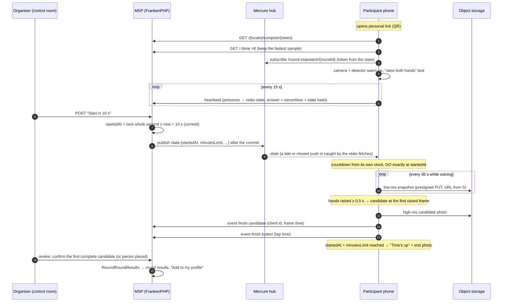

# Online competitions — automated timing (prototype analysis & brainstorm)

**Status:** brainstorm, 2026-10-13. Nothing is built. Decisions recorded in [§13](#13-decisions); the technical plan is [`implementation-plan.md`](implementation-plan.md).

**Motivation (Jan):** run online competitions without a crowd of judges — above all, the time keeping must be automatic. Target: 100 participants in parallel on lily.srv now, later thousands on a stronger server or several.

**Jan's brief, in short:**

1. **Preparation** - a competition is set up; every participant has a personal link / QR code with their name, works anonymously or signed in (signing in from the link comes back to it; a signed-in visitor is matched to the participant for good). The page shows the camera (pointed at the puzzle) and a stopwatch at 00:00:00.
2. **Start** - the organiser starts the round centrally: a countdown 10 → 0, then the stopwatch runs on every phone. Phones receive *the moment the countdown ends*, not a tick every second (Mercure / SSE), the rest is computed on the device - no drift.
3. **During** - the camera watches the puzzle and detects the finish (the puzzler raises their hands, the puzzle is whole with no missing pieces). A "Finished" button is the fallback; the time between the camera's detection and the button press is measured (delta).
4. **End** - the time runs out, everybody stops.

Fine-tuning is out of scope: the goal is a real-life flow that works end to end and proves the concept.

**Jan's additions during the brainstorm (2026-10-13):**

5. **Open source only** - no paid external tools or APIs. Everything is self-hosted on our Hetzner infrastructure (servers + Object Storage, already paid for).
6. **Seeing the participants** - the moderators / commentators at least, ideally the participants each other: "basically our own Google Meet".
7. **The studio** - the host invites finishers to talk with them on air, as online events often do.
8. **Media streams to S3**, with a fallback when Hetzner Object Storage is down (§5.11).

---

## 0. TL;DR

0. **Today's online events** run on Zoom / Google Meet: a sealed puzzle unwrapped on camera, a spoken countdown, self-started timers, "done" (or Speedpuzzle.eu's Done button) and a judge watching the cameras. Nobody uses computer vision for this (§2). The prototype automates the judge's two jobs - **the time and the evidence**.
1. **One clock per round - the existing round stopwatch, taught to count down.** "Start" schedules the start on a whole second ≥ 10 s ahead (`stopwatchStartedAt` in the future *is* the countdown). Phones get that one timestamp and compute countdown, stopwatch and time limit locally from a server-synced clock. Two or three messages per round (start, perhaps a cancel, an early end), never a tick.
2. **Clock sync = NTP-style over HTTP with min-RTT filtering**, millisecond server time, re-checked on every heartbeat. Expected error: tens of milliseconds - far below the one-second resolution of a result.
3. **Push via Mercure, but never depend on it.** The public `/round-stopwatch/{roundId}` topic already exists. Phones also fetch the state on (re)connect, on wake-up, just before and after the start, and every heartbeat answer says whether the state changed - a lost push costs nothing.
4. **Personal link = a secret token per participant** (new column - today the only id is the participant UUID printed in the name-tag QR, which is not a secret). Works anonymously and statelessly; "sign in" returns to the link and connects the participant to the account through the existing `ConnectCompetitionParticipant`, with guards (§5.4).
5. **The phone does all the vision work; the server never analyses video.** On-device MediaPipe (pose / gesture models, in a Web Worker) detects **raised hands** and timestamps the frame. Each detection is a *finish candidate* with a high-resolution photo and a **finish burst** (±5 s of frames), so a reviewer can pin the exact moment when the detection was off. The **Finished button** is the fallback and the delta measurement.
6. **"No missing pieces" is decided on the photo, asynchronously.** Rule: *the official finish is the first candidate whose photo shows a complete puzzle.* Premature or accidental raises are harmless. In the prototype a person confirms (one reviewer gets through ~100 finish photos in 10-15 min); an automated check runs **advisory** next to it (open source: OpenCV holes on a plain contrasting mat + matching against the box image, later our own model trained on the collected photos) and graduates to auto-accept once its measured accuracy allows.
7. **Results go through the existing official-results path** (`RecordRoundResults`: seconds, or pieces placed at time-up), so the round results page and "Add to my profile" work unchanged.
8. **Load is tiny because the phones compute:** ~0.1 HTTP request/s and one SSE stream per participant. 100 participants ≈ 10 req/s - nothing for lily. 1,000 works with small changes; 10,000 needs a tuned / separate Mercure and a load test through Traefik (§6).
9. **Media streams straight from the phone to S3** (presigned URLs - no bytes through PHP or on any server disk), with a self-hosted second store (Garage / SeaweedFS) for when Hetzner Object Storage is down and the phone itself as the buffer; timing never depends on storage (§5.11).
10. **Our own "Google Meet", self-hosted: LiveKit (Apache-2.0).** Every phone publishes its puzzle camera to a hall room. Moderators watch a live grid where a finish jumps to the top; the host's voice reaches everyone. A separate **studio room** is where the host brings finishers on air; spectators - possibly thousands - watch it on MSP (WebRTC, HLS at scale) or on YouTube. Participants may see each other per competition (in small groups at scale). 100 participants fit one media node (§5.12).
11. **Open source only:** every component is open source and self-hosted; Hetzner (servers + Object Storage) is the only thing paid - and already is.
12. **Before building detection, record real solves** (15-20 videos, several phones and set-ups) and build a bench - the same recipe as the barcode scanner research. The core flow (links, countdown, stopwatch, button, evidence, review) can be built in parallel and already runs a real online event with a button.

---

## 1. What the prototype must prove

Measurable success criteria for the proof of concept:

| # | Criterion | How it is measured |
|---|---|---|
| P1 | Every phone shows GO within ±100 ms of the official start | clock-sync telemetry from every device + filming several phones side by side |
| P2 | No official time is typed by a person: start = server schedule, finish = a device timestamp | data model - the review only *chooses* between recorded moments |
| P3 | Raised hands are detected for most real finishes within ~1 s of the exact moment; the button covers the rest. Autodetection reliability is the key to success - targets (e.g. ≥ 95 % detected, error ≤ 1 s) are set once the bench (S2) shows what is realistic | detection vs. the reviewer-confirmed moment (finish bursts) vs. button, on the recorded footage and every test event |
| P4 | Delta (button − detection) is known per participant and as a distribution | stored for every finish with both moments |
| P5 | One person verifies 100 finishes in ≤ 15 min | review screen timing during the trial |
| P6 | A phone that loses the network for 2 minutes, reloads the page or loses the camera still ends with a valid result | scripted failure tests + the trial |
| P7 | 100 participants cost the site nothing measurable; 1,000 simulated participants pass through the real Traefik path | load test (§10, S5) |
| P8 | Moderators see every puzzle camera live; the host brings a finisher on air in the studio within ~10 s; 100 publishing phones run on one media node | trial event + `lk load-test` (§10, S6) |

**Out of scope for the prototype:** pairs/teams (solo rounds only), spectator live leaderboard, anti-cheat beyond evidence + flags, native-app specifics, paid entries, paid services of any kind.

---

## 2. How online competitions run today

From the published rules of USAJPA's virtual contests, speedpuzzling.com, Speedpuzzle.eu's Euro Jigsaw Jam, the Canadian and New Zealand associations, Artifact Puzzles and the WJPC 2026 rules (research 2026-10-13; main sources: [USAJPA virtual contest rules](https://docs.google.com/document/d/1Rs_3EVs9C-75iHnvV9imbhCwjb3Gy1Rc) (undated), [speedpuzzling.com contest day](https://speedpuzzling.com/contest-day.html), [Speedpuzzle.eu timer instructions](https://speedpuzzle.eu/Timer-Instructions), [WJPC 2026 rules](https://worldjigsawpuzzle.org/wjpc/2026/rules), [WCA regulations](https://www.worldcubeassociation.org/regulations/)):

- **Everyone gets the same sealed puzzle by post**, joins a **Zoom / Google Meet call** with the camera on the table, and **unwraps on camera just before the start** (EJJ: 2 minutes before; USAJPA: outer packaging and cellophane right before GO). Judges check the unopened package and every camera angle first.
- **Camera rules:** landscape, the whole puzzling space (and hands) visible all the time; speedpuzzling.com asks for ≥ 12" above the table and 3-4 ft away because "any lower, and we can't really tell how many pieces are remaining"; a plain table surface is recommended; one device per entry, the Zoom name matching the registration. Contest puzzles are pre-tested for glare.
- **Start:** the organiser counts down on the call; **every puzzler starts their own timer** (it must be visible on camera).
- **Finish:** the puzzler unmutes and says "done" (or presses **Done** on Speedpuzzle.eu's timer website - the only timing tool found: central countdown, Done, remaining pieces typed in); a human then checks the puzzle on camera. **Raised hands are an in-person convention** (WJPC: say "TIME"/"STOP", or raise a hand if no judge noticed) - no online rulebook uses them.
- **Unfinished:** remaining pieces (EJJ, NZ) or placed pieces in connected groups (speedpuzzling.com ≥ 2, WJPC ≥ 3). WJPC adds 5 s per missing piece (2+ adjacent missing = manufacturing defect, no penalty).
- **The admitted weak spot** (USAJPA): "it can be difficult to keep an eye on multiple teams if finishing times are close" - settled by comparing self-reported times or reviewing a recording.
- **Nobody uses computer vision** for this. Published CV work solves puzzles from photos of loose pieces; checking a *finished physical puzzle from a live camera* is barely covered and no accuracy figures exist. Remote speedcubing is the same picture: self-timed uploads (csTimer battles), full-session videos checked by staff (Cubelelo), smart cubes that certify solves (Red Bull qualifiers); the WCA itself separates *stopping the time* from *the judge deciding whether it is solved* (A6, 10b) - the same split this design makes.

**What that means for MSP:** the prototype automates exactly the two jobs the Zoom judge does today - the time (a server-scheduled start instead of a spoken countdown and self-started timers; a device timestamp instead of a self-reported time) and the evidence (photos at the moments that matter instead of watching 40 cameras). The proven basics stay: the sealed package unwrapped on camera, framing rules, one device per entry. Phase 1 alone (§12) already matches Speedpuzzle.eu's timer website and adds evidence and MSP's results; the camera finish is new ground.

---

## 3. What already exists (reuse map)

Verified in the code on 2026-10-13.

| Need | Existing piece | Gap for online rounds |
|---|---|---|
| Online events and rounds | `Competition.isOnline`; `CompetitionRound` with `minutesLimit` (always set, NOT NULL), `startsAt`, `timezone`, `category` | none (solo only in the prototype) |
| A round clock | **Round stopwatch**: `CompetitionRound.stopwatchStartedAt` / `stopwatchStatus` / `stopwatchStoppedAt`, public projector page `/round-stopwatch/{id}`, manage page, public Mercure topic `/round-stopwatch/{roundId}` (prod hub allows `anonymous`), state endpoint `round_stopwatch_state` | start is always *now* (no countdown); columns are `TIMESTAMP(0)`; `serverNow` is sent in whole seconds (so today's offset is only ±0.5 s accurate); the handlers publish **inside** the handler, i.e. before the commit; no cancel; Stop/Start means pause/resume |
| Participants | `CompetitionParticipant` (name, country, `player`, `connectedAt`, `source`), entries `CompetitionParticipantRound` (unique per participant + round) | **no secret**: the name-tag QR encodes `/{_locale}/live/{competitionId}/p/{participantId}` |
| Connecting a participant to an account | `ConnectCompetitionParticipant` + handler (`SerializedByLock`, releases the player's other connections, refuses a participant linked to someone else) - **dispatched nowhere yet**; `JoinCompetitionHandler` (self-join, auto-match on one name + country) | a connect *by token* |
| Official results | `RecordRoundResults` (`{"seconds":n}` / `{"piecesPlaced":n}` / `{"didNotStart":true}`, three-way checked, receipts = idempotency, `CompetitionParticipantsLock`, acting player required), round results page, "Add to my profile" (`OfficialEntryTimePrefill`) | none - the review page sends changes as the organiser |
| Offline outbox | `assets/official_results_outbox.js` (IndexedDB, client UUIDs, batches ≤ 100, backoff, one sending tab via Web Locks, all I/O injected = testable under node) | reuse for participant events |
| Robust SSE client | `assets/official_results_events.js` (fetch-based SSE with a Bearer token, backoff, "silent for 100 s = dead", `Last-Event-ID`, token renewal) - already handles iOS's "dead EventSource still says OPEN" | needs a subscriber token per participant page (`OfficialResultsSubscription` pattern) |
| Clock offset | round stopwatch + live entry: NTP midpoint of *one* sample | min-RTT filtering over several samples, ms server time |
| Camera | `barcode_scanner_controller.js`: 1080p constraints, Android "camera 0, facing back" re-pick, focus kick, torch, `requestVideoFrameCallback` pacing, careful cleanup | no Wake Lock, no `visibilitychange`/`pagehide`, no track `ended`/`mute` handling; everything on the main thread; zbar comes from jsDelivr (not cached by the service worker) |
| Wake Lock | only the personal stopwatch (`stopwatch_controller.js`) | its `release` listener unticks the box, so the lock is never re-requested after the tab was hidden - don't copy that |
| QR codes | `bacon/bacon-qr-code` (`NameTagQrCode`) | none |
| Cheap high-frequency writes | `redis-state` (noeviction, AOF) + one Lua call per request on `kernel.terminate` (`RedisApiUsageCounter`) | reuse for presence/heartbeats |
| Object storage | Hetzner Object Storage, private bucket, Flysystem `FailoverS3Adapter` (spool + cron) | no presigned / browser-direct uploads anywhere yet |
| In-app browsers | `InAppBrowser` + notice (auth pages only) | reuse: camera pages need the real browser |
| JS unit tests | node scenario harness (`tests/live-results-harness.mjs` + `LiveResultsScriptsTest`) | clock sync, round state and finish detector become pure modules tested the same way |
| Permissions | `COMPETITION_EDIT` (clock control), `COMPETITION_RESULTS_ENTRY` (results) via `GetCompetitionPermissions` | none |
| Native apps | Turbo Native iOS/Android shells (`window.nativePlatform`); the barcode scanner already uses the camera inside them | untested for a 90-minute camera session - prototype targets the browser |
| Live video | nothing - Mercure carries data only | a self-hosted SFU (LiveKit, §5.12); its access tokens are plain JWTs, and `lcobucci/jwt` 5.6 / `firebase/php-jwt` 7.1 are already installed |

---

## 4. The flow end to end



| Phase | Participant phone | Organiser | Server |
|---|---|---|---|
| Preparation (days before) | opens the link, tries the set-up, practice run | creates the event + round (existing), turns on online timing, shares links (copy / CSV / QR sheet) | tokens |
| Before the start (~30 min) | opens the link, camera framed, checklist green, "ready" | control room: who is online / ready / clock quality / camera thumbnails | presence in Redis |
| Start | countdown 10 → 0 with beeps, GO | "Start in 10 s" (can cancel during the countdown) | one state change, one push |
| Solving | stopwatch, detector, snapshots, Finished button; the camera also goes live to the moderators | live video grid, finishes as they come, studio invites | events + photos stored; video through the media server |
| End | "Time's up", end photo, "pieces placed?" if unfinished | "End now" (or the time limit ends it) | one state change, one push |
| Review | "Your time: 47:12 - being verified"; finishers may be invited to the studio | review screen → confirm → publish | `RecordRoundResults` |

Live video (§5.12) runs next to the timing, never inside it: the media server carries the cameras to the moderators and the studio to spectators, while the clock, the detection and the evidence work exactly as without it.

---

## 5. Design

### 5.1 One clock per round: extend the round stopwatch

The round already has a central clock that phones can follow. Rather than a second clock for online rounds, teach it three things:

- **Start with a countdown.** "Start in 10 s" sets `stopwatchStartedAt` to the next whole second at least 10 s ahead, with a new status `scheduled` (any reader we missed then sees "not running" rather than a negative time). A start in the future *is* the countdown: every client shows `startedAt − now` until it reaches zero, and treats the round as running from then on. Aligning to a whole second keeps the existing `TIMESTAMP(0)` columns exact - no schema change for the start (the countdown lasts 10-11 s).
- **Cancel** while `now < startedAt` = reset (a wrong round, a late organiser).
- **End**: the time limit ends the round by itself (`startedAt + minutesLimit`, already how the projector page clamps). "End now" = the existing Stop (`stoppedAt`), stored rounded **up** to the next whole second (the column keeps whole seconds; a click at 39.926 s ends at 40 s, so a tap in that fraction still counts - in person a Stop is a pause and keeps rounding down). For online rounds there is no resume: participants keep solving on the other side of the world; a "pause" has no meaning for them. Start - now, in 10 s or at a set time - on an ended online round is refused (`RoundStopwatchRefusal::EndedUseReset`, `ended_use_reset` 409 as JSON: "This online round has ended - Reset it to run it again"), and the stopwatch pages offer no Start while it is stopped, only Reset (stream P1G).
- **Runs.** A run is one start of the round clock (its `startedAtMs`); "Reset" ends it and the next start begins a fresh one. Taps, undos, time-up pieces and the review's evidence count only for the current run - the events from its start on (`OnlineRoundState` taps, `OnlineReviewAssessment`, the control room's last tap, the accuracy report); an earlier run's rows stay stored, never deleted, listed in the review but never counted. The phone keeps its Finished taps and pieces per round + run (`compete_flow.js` `runKeyOf()`), its set-up (consent, ready, the empty mat) per round. A Reset of an online round is refused once the round has an official result (`results_confirmed` 409 on the stopwatch page - the results desk clears the results first, they belong to the run that was), and it clears every online entry's reported pieces and review decision (`OnlineEntry::startFreshRun()`), under the event's participants lock.

The same mechanism gives **scheduled starts** for free: "Start at 19:00:00" just stores that moment ahead of time. Phones show "Starts in 2:13:05" for hours and the last 10 s as the countdown; nobody has to press anything at 19:00. Pressing "Start in 10 s" is the special case of a 10-s lead.

What the existing code needs for this:

- **Every reader of the stopwatch state treats a future start as "not started yet"**: the projector page, the referees' live entry (`finishedNow()`), the manage page. Small, pinned by tests.
- **Publish after the commit.** Today `StartRoundStopwatchHandler` publishes inside the handler, before `doctrine_transaction` commits. With a countdown, a rolled-back start that was already announced would start every phone. Publish after the commit, as the official-results updates already do.
- **Milliseconds on the wire.** The state endpoint sends `serverNow` in whole seconds, so clients can't sync better than ±0.5 s. Add `serverNowMs`, `startedAtMs`, `stoppedAtMs` (keep the ATOM fields for the projector page).

Side benefit: the projector page gets a countdown for free (streams of online events, in-person events alike), the referee live entry keeps working, and "when did this round start" has one answer.

Alternative considered: a separate online clock (own table, ms precision). More code and two clocks per round to keep consistent - rejected.

### 5.2 Clock sync on the phone

```js
// one sample: the server's ms time against the phone's monotonic clock
const t0 = performance.now();
const { serverNowMs } = await (await fetch('/-/time', { cache: 'no-store' })).json();
const t1 = performance.now();
const rtt = t1 - t0;
const offset = serverNowMs - (performance.timeOrigin + t0 + rtt / 2); // server − local
// keep the sample with the smallest rtt; its error is at most rtt / 2
```

- **Initial sync:** 8 samples ~150 ms apart at page load over the already open HTTP/2 connection; keep the min-RTT sample (the first sample usually pays for the connection set-up and is discarded by the filter). Where available, Resource Timing's `requestStart` / `responseStart` replace `t0` / `t1`, so time the request spent queued inside the browser is left out.
- **Continuous:** every API answer carries `serverNowMs` (heartbeat every 15 s, events, state), so every request is a free sample. Keep a sliding window, use its min-RTT sample.
- **Local time is `performance.timeOrigin + performance.now()`** - it never jumps when the system clock is changed. But it **stops while the device sleeps** (on every platform except Windows) and can drift slowly from wall-clock time, so the offset is re-measured on `visibilitychange`, `pageshow`, whenever `Date.now()` and `performance.now()` disagree about how much time passed, on every heartbeat, and right before and after the start. Small corrections are applied gradually (no visible jump of a running stopwatch); a correction after sleep is applied at once (the page was hidden anyway).
- **Everything else is arithmetic:** `countdown = startedAtMs − serverNow()`, `elapsed = serverNow() − startedAtMs`, `remaining = startedAtMs + minutesLimit·60 000 − serverNow()`. Rendering runs on `requestAnimationFrame`; nothing accumulates, so nothing drifts.
- **Readiness gate:** a device without a sync sample under ~1 s RTT is "not ready" (a phone with a clock off by minutes would otherwise start at the wrong moment). The control room shows each device's offset and RTT.
- **Endpoint:** `GET /-/time` → `{"serverNowMs": 1760380800123}`, `no-store`, added to the existing `stateless` firewall (`security: false`, like `/-/stale-document`) - no session, ~1 ms in worker mode. Could later be answered by Caddy itself without PHP; not needed at this scale.
- **Delta needs no sync at all:** detection and button times are both taken on the same device, so the offset cancels out of `button − detection`.

Expected accuracy: the error is bounded by half the fastest round trip (the two directions can take different times) - single-digit ms on good Wi-Fi, tens of ms on mobile data; Safari's clock resolution is 1 ms. A result has one-second resolution; the finish detection itself (frame rate, the hands going up) is the larger error. To be confirmed on real devices (spike S4).

### 5.3 Realtime: how phones learn about start, cancel and end

- **Topic:** the existing public `/round-stopwatch/{roundId}`. The payload is the full state plus the server time it was read (`asOfMs`, taken when the row is read, not when the answer is sent) - idempotent; the phone keeps whichever state is newest, so a slow fetch can never overwrite a newer push. No version column needed; the heartbeat answer carries a short hash of the current state.
- **Client:** `official_results_events.js` (fetch-based SSE with a Bearer token, silence detection, backoff). The participant state carries a subscriber token for the round topic (minted like `OfficialResultsSubscription`, no account needed - the personal token was checked). This also allows a private per-participant topic later (e.g. "verified", "opened on another device").
- **Never depend on the push alone.** The phone fetches the state on (re)connect, when the page becomes visible, 2 s before and 1 s after `startedAt` (catches a missed cancel), and whenever a heartbeat answer's state hash differs from its own. If Mercure is down, the 15-s heartbeat still delivers a start within ~15 s - with a 10 s countdown the phone just shows a shorter countdown or starts at the correct elapsed time. Correctness never depends on when a message arrives, only on the timestamp in it.
- **Why not WebSockets:** traffic is one-way (server → phones, two or three messages per round); upstream is plain HTTP. Mercure is already deployed.
- **Late joiners** (page opened after the start) see the running stopwatch at the right value - the time counts from the official start for everyone.
- **The organiser's settings reach open pages** (stream SP). The state's round carries `settings` (finish detection, live video, see each other, the studio, what time's up asks) and `settingsHash` - their short hash (`OnlineParticipantSettings`, the one definition; the recording, the missing-piece rule and the studio's YouTube link are not in it: no phone uses them). The heartbeat answer carries `settingsHash` next to the clock's `stateHash` (both from `OnlineAccessLight`'s per-round cache - still no Postgres), and a save on the online timing page, once committed, forgets that cache and publishes `{type: "online.settings", roundId, settingsHash}` on the round's stopwatch topic (`OnlineRoundSettingsLiveUpdates`): a phone holding another hash fetches its state, spread over up to a second (`round_state.js` `needsStateFetch()`). A typed message is never a stopwatch state - every other reader of the topic lets it pass; it has no `asOfMs`, so a page loaded before it existed fetches its state too. Mercure down: the next heartbeat (≤ 15 s + the 2 s cache). Measured locally (2026-10-14: the prod-mode stack of `tools/online-load/local-stack.sh`, Selenium Chromium as the phone, a second browser as the organiser): the push reached the phone 11-110 ms after "Save settings", the state was fetched 0.06-1.04 s after it (the spread) and the phone showed the change 20-30 ms later (the reload banner 1.07 s, gone 0.28 s; the detection row hidden 0.97 s, back 0.95 s; time's up asking "placed" from the state at 0.07 s); with Mercure stopped 14.8 s and 0.25 s - whenever the next heartbeat fell. What the phone does with them:
  - live video, see each other, the studio: at once, before, during and after the round (`compete_video_page.js` plans by the state every frame) - the hall joined or left, who may watch and the strip, the studio ended when video goes off; the camera track, the frame grabber and the clock are never touched;
  - time's up asks by the newest measure (pieces left / placed);
  - finish detection: **fixed from the round's start until a Reset** (`OnlineRound::detectionModeLockedAt()` - scheduled, counting down, running or over: the settings form shows the field disabled with the reason, `UpdateOnlineRoundSettingsHandler` refuses another mode with `OnlineDetectionModeLocked`, also when a page opened before the start sends one). Before GO a page with the detection parts switches between `shadow` and `on` at once (the hold on "I'm ready", the hints, the machine) and `off` stops the detector (the worker terminated, a running set-up test is untested, never failed; on again = one new worker). A page **without** the parts (loaded while the detection was `off`) shows on its screens before the start a calm banner "The organiser turned on finish detection - reload the page to use it" with a Reload button - never a reload by itself; not reloaded, it competes with the Finished button (its heartbeat says `state: off` - the control room's "Button only"; the accuracy report counts its finishes as "detector not running"). The page of a round whose detection is off stays the page without the parts - only the banner's two texts are in its texts block (the script builds the banner when needed).

### 5.4 Personal links, QR codes, sign-in, account matching

**Token.** New nullable unique column on `competition_participant` (e.g. `online_token`, 128 random bits, ~22 characters base58), generated when the organiser turns on online timing (or opens the links page); "New link" regenerates it and kills the old one. A database token rather than a signed URL: it can be shown again, revoked per person, and printed.

**URL.** `/{_locale}/compete/{token}` (route paths translated like every other route). The QR encodes the full URL. On a computer the page shows "Continue on your phone" with the QR - the natural path for someone who got the link by e-mail.

**Distribution.** The organiser's links page: copy one link, CSV of all links, a printable sheet with QR codes (bacon-qr-code). Signed-in players connected to their participant don't need the link: the event page shows "Open my competition page" for them.

**Anonymous works fully and statelessly.** No session cookie for an anonymous participant: the token authenticates every API call (`/api/compete/{token}/…`, a stateless firewall pattern like `/api/v1/`). JSON POSTs authenticated by a path token need no CSRF token (no cookie authority involved). Rate-limited per token. The page itself is `no-store` (it carries the token) with `Referrer-Policy: same-origin` (`no-referrer` breaks stateless CSRF - known gotcha).

**Sign-in from the link.** "Sign in to keep this result on your profile" → `/login?return=/{locale}/compete/{token}` (validated by `ReturnUrl::tryFrom()` as always). Back on the page:

| Situation | What happens |
|---|---|
| Participant not connected, the signed-in player is not another participant of this competition | **connected automatically** (the page POSTs it - a GET never writes, mail scanners and prefetchers open links) through the existing `ConnectCompetitionParticipant`; toast "Connected to your profile" |
| Already connected to this player | nothing |
| Connected to another account | nothing changes; "This link belongs to another account" (still usable for competing) |
| The player is already *another* participant of this competition | no automatic connect; explain, the organiser fixes it in the participants sheet |
| Organiser / maintainer / admin opening a participant's link | "Preview as organiser" banner, no automatic connect, an explicit "This is me" button |

"Matched forever" = the existing participant ↔ player link, which carries the official result to the player's profile.

**Several devices on one link.** The page registers a device id. The latest device that opens the camera *takes over* (the previous one shows "Opened on another device" via the private topic or the next heartbeat). A device gives way to a heartbeat answer only once its own claim (`device.ready`) is stored and 3 s old - an older answer may predate it (`compete_flow.js` `takeoverVerdict()`) - and never switches back by itself: the device that lost the link stops within one heartbeat (≤ 15 s + a round trip; measured in the harness: worst 15.0-15.7 s, 0.8-4 s when both were tapped within seconds), and two devices tapped back and forth never flap - the last tap wins. A second-screen role (stopwatch + button only, e.g. a laptop) fits the same model - see §5.5.

### 5.5 The participant page

One page, its screens driven by the round state:

| Screen | What it shows |
|---|---|
| **Welcome** | competition, round, the participant's name ("Not you?"), language, "Sign in to keep this result on your profile", consent to the photos (§8). In an in-app browser (Instagram, Messenger, …): "Open this in your phone's browser" (`InAppBrowser`). On a computer: "Continue on your phone" + QR |
| **Set-up checklist** | camera permission + live preview with a framing guide (whole puzzle area + upper body), camera choice (front/back, remembered), **"Raise both hands"** test ✓, clock synced (± ms), detector loaded, screen stays on, charger reminder, connection. Each row green / amber / red. "I'm ready" (the tap also unlocks audio for the beeps) |
| **Waiting** | stopwatch 00:00:00, "Waiting for the organiser" or "Starts in 2:13:05" for a scheduled start, the time limit, camera preview |
| **Countdown** | full screen 10 → 1, beeps on the last three, GO (+ vibration where supported) |
| **Running** | the stopwatch, readable from a metre away (digits ~15-20 % of the screen width), detection status, a big **Finished** button (tap = finish + 10 s "I tapped by mistake") |
| **Finish recorded** | the recorded time big, "being verified", the running clock small |
| **Time's up** | alarm, "Stop puzzling", pieces left (or placed - the competition's measure) if unfinished |
| **After** | "Results after verification", link to the round results; anonymous: "Sign in to keep this result" |

**Practice mode** on the same page: a personal clock ("Start a 1-minute practice") to try the set-up and the hands-up detection days before the event, without the organiser. It lowers the support load on the day and - with consent - yields footage for the bench. After the round the after screen still offers it, without the hint "any time before the round" (stream RP).

**The top bar** (stream RP, the rehearsal at 360 px): who the phone is for comes first - the participant's side keeps its width (up to 70 % of the bar), the event's name takes what is left and is cut with an ellipsis first; a status word never breaks inside itself (the items wrap as wholes, one too long on its own is cut).

**Set-up rules for participants** (today's organisers' rules, to be confirmed by the footage, S1): phone on a stand, landscape, ≥ 12" (30 cm) above the table and 3-4 ft (1-1.2 m) away, charger connected, a plain mat in a contrasting colour, the whole puzzling space, all pieces and the hands in view at all times (raised hands too), light from the side or above (no window behind the puzzle), one device per entry. With the **front camera** the screen faces the puzzler (they see the clock and their own framing); with a top-down mount the screen is out of sight - the second-screen role (§5.4, §13) covers that.

**Browser realities** (research 2026-10-13, checked in the engines' source where possible; iOS 27 shipped on 2026-09-17 and joins the test list):

| Fact | Consequence for the page |
|---|---|
| **iOS mutes the camera whenever the page is hidden** (side-button lock, app switch, tab switch) and unmutes it on return; bug reports show tracks that end or stay muted, incl. a `pushState` regression (17.4.1), and home-screen apps re-asking for camera permission after route changes | the page must stay visible for the whole round: wake lock + a loud full-screen state when the camera stops; listen to `mute` / `unmute` / `ended` and re-open the camera; **the whole session lives on one page - no Turbo visits, no history changes** |
| **Android Chrome releases the camera** when the screen turns off or another app comes to the front, and restarts it on return | same handling; the outage becomes `camera.lost` / `camera.back` events for the review |
| **Screen Wake Lock**: Chrome / Android 84, Firefox 126, Safari 16.4; on iOS **home-screen web apps only from 18.4**; Safari grants the *first* lock only right after a tap; every browser releases it when the page is hidden; `NotAllowedError` is a normal outcome (power saving) | request it on the "I'm ready" tap, again on every `visibilitychange` back to visible; show it as a checklist row, never rely on it alone |
| **`performance.now()` stops during device sleep** (everywhere except Windows) and can drift from wall-clock time | re-measure the clock offset on visibility, when `Date.now()` and `performance.now()` disagree about elapsed time, and every heartbeat (§5.2) |
| **iOS drops an SSE stream ~20 s after the page goes to the background**, and since iOS 18 the dead `EventSource` still reports OPEN | the fetch-based client with silence detection (§5.3) + a state fetch on every return |
| `requestVideoFrameCallback` (Chrome 83, Safari 15.4, Firefox 132) - all three engines fill `captureTime` | frame timestamps for the candidates |
| `OffscreenCanvas` 2D: Safari 16.4; **WebGL2 in workers: Safari 17**; MediaPipe runs in workers on Safari 17+ | detector in a worker on iOS 17+; older iOS falls back to the main thread at a lower rate |
| `ImageCapture.takePhoto()`: Chrome / Android 60, **Safari / iOS 18.4**; Firefox behind a flag | full-sensor stills are possible later; the prototype grabs frames from the 1080p stream everywhere |
| No browser caps the camera resolution; 1080p from the front camera is normally available, 4K depends on the phone | ask for 1080p, read the real size back (`videoWidth` / `getSettings()`) and report it |
| A page can't read the phone's temperature (Compute Pressure is desktop Chrome only); the Battery API is Chrome only | charger is a rule, not a check; frame rate adapts to the measured inference time |
| Audio needs a user gesture; `navigator.vibrate` doesn't exist on iOS | the "I'm ready" tap unlocks the beeps; vibration is a bonus on Android; a page loaded again after "I'm ready" asks "Tap here once - so you hear the start …" before GO, "… so you hear time's up …" while the round runs (stream RP) and nothing after the end (time's up / the after screen have no sound left to wait for) |

**Support floor (proposal):** Safari 17+ (iOS 17+) and a current Chrome on Android for the camera finish; anything older competes in button-only mode with the evidence photos it can take.

### 5.6 Upstream: events, outbox, presence, evidence

**Events** (phone → server), each with a client UUIDv7 (idempotency), the client's server-clock time in ms, the raw `performance.now()`, the offset and RTT used, and a payload. The server adds its receive time.

| Event | When | Why |
|---|---|---|
| `device.ready` | checklist green | readiness, device facts (browser, camera, resolution, detector fps) |
| `countdown.seen`, `start.seen` | the phone showed the countdown / GO | measures push latency and start skew |
| `finish.candidate` | raised hands detected | the finish moment(s), with the photo id |
| `finish.button` / `finish.button.undone` | tap / "I tapped by mistake" within 10 s | fallback + delta |
| `camera.lost` / `camera.back`, `page.hidden` / `page.visible`, `network.offline` / `online` (logged afterwards) | as they happen | flags for the review |
| `page.reloaded` (stream RP) | a page (re)opened while the round runs, on a device that was ready - a reload, a tab the browser brought back, the link opened again; once the clock is synced (or after 10 s), stamped with the load's moment; `goneMs` = how long the page before it was gone (the last alive mark on the device: every heartbeat, hidden, `pagehide`), null when unknown. Never in a practice, a preview or on a second screen | the review's flag "Page reloaded" and its line in the timeline ("Page reloaded - gone for 00:00:02.3"); it is also the return of that device's `page.hidden` (the old page went hidden as it went) |
| `timeup.pieces` | participant reports pieces left / placed | unfinished result |

**Outbox.** Events go into IndexedDB first and are sent in batches, retried until acknowledged (`official_results_outbox.js` pattern: one sending tab, backoff, `beforeunload` warning while anything is unsent). A finish recorded offline keeps its exact time; the server marks it "arrived late" and the review sees by how much.

**Presence = heartbeats in `redis-state`, never Postgres.** Every 15 s: device id, camera ok + resolution, detector fps, clock offset/RTT, page visible, last event. One Lua/HSET per heartbeat into `online:{roundId}:presence`, TTL a few hours. Only the device holding the entry (the last one ready - any while none is) writes the participant's presence; another device on the same link (a second phone, a laptop that never agreed to the photos) is kept apart and shows in the control room's data as `otherDevice` - on the participant's tile as the chip "Also open on another device" while that device beats (seen within the last 45 s, `review_control.js`). The answer is `{serverNowMs, stateHash}` - a clock sample and a state check in one.

**Evidence photos** (JPEG, private object storage `online/{competitionId}/{roundId}/{participantId}/{photoId}.jpg`):

| Kind | Resolution | When |
|---|---|---|
| periodic | ~640×360, ~35 KB | every 30 s to the end (control-room thumbnails, timeline, training data); every 10 s in the last 3 minutes before GO, which cover the unwrapping on camera |
| empty mat | stream resolution | during the set-up, before the unwrapping (baseline for the background-holes check, §5.8) |
| start | stream resolution | at GO: the package was unwrapped on camera, the pieces not touched yet (§7) |
| candidate | stream resolution (1080p) | every finish candidate - the photo the completeness check judges |
| button | stream resolution | every Finished tap |
| **finish burst** | ~640×360 JPEG frames at ~10 fps, each with its capture time (~1-2 MB per burst) | **±5 s around every candidate and every tap** - the phone keeps the last ~5 s of frames in a ring buffer (~1 MB of memory) and adds the next ~5 s. The reviewer scrubs it to the exact moment (§5.9) |
| end | stream resolution | at time-up for everyone still solving (pieces-placed check) |

Uploads go **from the phone straight to object storage** through presigned URLs, with a second store and the phone as buffer when the primary is down (§5.11). That is ~3 uploads/s for 100 participants, none of them through PHP.

**The phone records no continuous video in the prototype.** Photos and the finish bursts answer "what did the table look like, and when exactly" for the review and the dataset. The live video goes through the media server and can be recorded there (§5.12). A recording by the phone itself would be a later step with its own decision: MediaRecorder writes MP4 on iOS (WebM too from 18.4) and WebM / MP4 in Chrome; a 60-120 min recording at 720p is ~1-2 GB, which must never sit in memory (iOS reloads the page under memory pressure) - timed chunks uploaded as they come, or written to OPFS; after a camera mute, Safari's chunks balloon. Segments around the finish are the likely first use.

### 5.7 Finish detection (camera)

**Where the vision work runs:**

| Option | Server cost | Works at 10,000 | Notes |
|---|---|---|---|
| **On the phone** (recommended) | none | yes | each phone analyses its own camera at a few frames per second; the server receives events and photos |
| Detection on the server, from the video the SFU receives anyway (§5.12) | decoding + ~0.03 CPU-s per analysed frame per participant: ~3 cores at 1 fps for 100, ~300 for 10,000 | no | harder to cheat; but the video reaching the server is the small adaptive layer, and the cost grows with every participant |
| Hybrid: phone detects, server checks only the photos at the candidate moments | a few photos per participant | yes | = the recommendation together with §5.8 |

**What is detected: raised hands.** A deliberate "I'm done" signal and something today's models detect reliably. It is *new* for online events (today they say "done" or press Done; raising a hand is the in-person way to call a judge, §2), so organisers announce it as the rule and the set-up step makes every participant try it once. The camera placement decides the model, so the set-up step tries both and keeps the one that sees the participant's test raise:

- **Angled view** (phone 3-4 ft away, ≥ 12" above the table - the framing organisers already ask for - sees the puzzle and the puzzler's upper body): MediaPipe **Pose Landmarker** (lite) - both wrists above the shoulders.
- **Top-down mount** (sees only the table, raised arms leave the frame): MediaPipe **Gesture Recognizer** - two `Open_Palm` hands shown to the camera; or, if the bench prefers it, "both hands out of the puzzle area for N seconds, then a still frame".

Rules (all tunable, pinned by node tests over recorded signal sequences):

- A raise held for **≥ 0.5 s** becomes a **finish candidate**. Its time is the **capture time of the first raised frame** (`requestVideoFrameCallback` metadata), so the hold and the inference cost don't delay the recorded moment.
- At the candidate the phone grabs the sharpest full-resolution frame of the raised window (hands away from the puzzle - the best moment for the photo) and uploads it, together with the **finish burst**: ±5 s of frames from the ring buffer, so the exact moment can be checked when the detection was imprecise (§5.6, §5.9). The same burst is taken around every Finished tap.
- **10 s cooldown**, then a later raise is a new candidate - the participant noticed a gap, kept going and raised again. Because the official finish is the *first candidate whose photo shows a complete puzzle* (§5.8), a premature or accidental raise is harmless.
- **Arming** (stream P2F): a raise that was already going on when the detector began to look is never a candidate - nobody saw the hands go up, so nobody knows when they did. The finish machine starts **unarmed** - at GO (it looks from GO + 1.5 s), after every gap in its frames (a hidden page, a frozen camera, a camera restarted or taken over; the frame that ends the gap included) and after the participant's Finished tap - and **arms** once the hands were seen down for ≥ 600 ms of consecutive frames (at least 3 of them: "down" as sure as the 0.5 s "up"); only then may a raise start. Hands held up through GO or through a hidden page give no candidate until they are lowered and raised again; the moment of an armed raise is unchanged (its first raised frame). A frame captured before the detector (re)began to look never reaches the machine. The set-up test's machines arm the same way: the test proves the whole down-and-up cycle the round needs, and a detector that reads "raised" all the time (a poster, an odd pose) fails the test instead of passing it and never arming in the round. `FINISH_MACHINE_VERSION` 2 (stored with every candidate).
- **Detection stops after Finished** (stream P2F): once the participant taps Finished the detector looks at nothing (the `finished` screen); "I tapped by mistake" / "Keep puzzling" brings the running screen back and the detector with it - unarmed. A candidate is never recorded after the participant's own tap, and the review never suggests a candidate that came after a tap over the tap (§5.9).
- "Last touch" (when movement over the puzzle stopped, from frame differencing) is logged as a research signal, not used for the time.
- Inference at 4-5 fps on a downscaled frame (the pose model's input is 256×256 anyway); the camera stream itself stays at 1080p for the photos.

**Modes per round:** `off` (button only), `shadow` (detected and stored, not shown; the button is the official moment - the cleanest delta data, because participants don't react to the detection), `on` (the detection is shown and is the suggested official moment, the button is the fallback). Jan's brief is `on`; see §13. The mode is **fixed from the round's start until a Reset** (stream SP, §5.3 "The organiser's settings reach open pages"): every phone decided at GO what a raise means, and the review reads them by the same rule.

**`shadow` in detail** (stream P2F): invisible to the reviewer too - the review lists the taps only (no candidates, no candidate photos or bursts, no detector reports; `G` steps through the taps as in `off`) and a confirmation with source `detection` is refused (`detection_not_shown`, 422); the accuracy report has every candidate. And it never holds anybody up: "I'm ready" does not wait for the detector (no 15 s wait, no skip) - it loads in the background and starts looking once loaded, with the view the device's set-up test chose, else `angled` (the default for an untested device). The checklist row and the set-up test stay: the instruction to raise both hands is the same in both modes, only the feedback while puzzling differs.

**What the participant sees in `on` mode:** a green flash and a chime, "Finish recorded at 47:12 - if a piece is missing, keep going and raise your hands again." The recorded time is shown big; the running clock continues small until the round ends or the participant taps "Finished" (which records the tap time the same way - fallback and delta). "Done? Raise both hands - or tap Finished." shows only while the detector watches (an answer within 3 s); otherwise - the camera restarting or frozen, the detector still loading, button only - "Tap Finished when your puzzle is complete.": the page never asks for a raise nobody would see.

**Tech:**

- `@mediapipe/tasks-vision` (1.1.0, 2026-10-06): `PoseLandmarker` / `GestureRecognizer` with `runningMode: 'VIDEO'` and `detectForVideo(frame, timestampMs)`. The calls are synchronous and block their thread, so they run in a **Web Worker** (`assets/online/detector.worker.js`) fed with transferable `ImageBitmap`s grabbed on `requestVideoFrameCallback`; older browsers run it on the main thread at a lower rate. *Built (stream DB, 2026-10-13):* Encore bundles the worker as its own chunk but rewrites `{type: 'module'}` away, so it runs as a **classic** worker - it checks which kind it is and loads the matching MediaPipe loader (the bench runs the same file as a module worker); MediaPipe is loaded by a `webpackIgnore` import of a pinned URL, never bundled - in production from our own copy ("Downloads" below), in dev and tests from jsDelivr and Google's numbered `float16/1` model paths.
- **CPU delegate.** "GPU" means WebGL2 (no WebGPU option for the vision tasks), and on iOS the GPU mode gives wrong segmentation results (MediaPipe #6142, open - the pose / gesture tasks unconfirmed) and crashed Safari's GPU process in an iOS 27 beta. At 1-5 fps the CPU mode leaves headroom. **One detector instance** for the whole session - creating and disposing detectors runs Safari out of memory (#5036).
- Speed: no published web numbers for mid-range phones. Native Pixel 6: hand landmarker 17 ms (CPU) / 12 ms (GPU), gesture 16.8 / 20.9 ms; the older pose library ran pose lite at 32 fps on a Pixel 5. At 5 fps that's a fraction of one core - to verify on older iPhones and mid-range Android over 90 minutes (spike S3).
- **Downloads:** pose lite 5.8 MB, gesture recognizer 8.4 MB, WASM runtime 13 MB - **13.2 MB on the wire** with our brotli (bundle 38 KB, loader 67 KB, WASM 2.65 MB, pose 4.59 MB, gesture 5.87 MB; the CDNs sent 17.8 MB - jsDelivr's lighter brotli, Google's models uncompressed), fetched during the preparation (the checklist waits for it), then the browser's HTTP cache. **Not under `/build/`**: the image carries old `/build` files for 7 days and the service worker buffers whole bodies in memory.
- **Production serves them itself** (stream MH, 2026-10-14 - open source *and* self-hosted, Jan): `public/online-detector/<tasks-vision version>-<models>/` (today `1.1.0-pose-lite-1-gesture-1/`), laid out like the CDN paths - `vision_bundle.mjs`, `wasm/` (all six loader + binary files: classic / module worker, with / without SIMD), `pose_landmarker_lite.task`, `gesture_recognizer.task`, `LICENSES.txt`. Same origin: no CORS, no third party seeing the participants' IPs, nothing from a CDN running inside the worker that sees the camera.
  - *Built into the image:* the Dockerfile's `online-detector` stage (a pinned Node image) runs `bin/fetch-online-detector.mjs --precompress`: the npm tarball of `@mediapipe/tasks-vision` (its sha512 = the `integrity` package-lock.json pins - package.json lists the package with the exact version, but nothing imports it and the image drops its `node_modules` copy) and the two models from Google's numbered paths (SHA-256 + size pinned) - any other byte fails the build - plus a `.br` (quality 11) and a `.gz` beside each file. Only the script and the licence text feed the stage, so the registry cache keeps it until a pin changes; the daily base image rebuilds never redo the ~90 s of brotli. +95 MB in the image (53 MB of files + their `.br` / `.gz`).
  - *Served:* `.docker/online-detector/online-detector.caddyfile`, copied to `/etc/frankenphp/Caddyfile.d/` (the base image's Caddyfile imports that directory): `Cache-Control: public, max-age=31536000, immutable` (a missing file `no-store`, never PHP), `precompressed br gzip` (`Vary: Accept-Encoding`), `application/wasm` / `text/javascript` from the MIME table, `application/octet-stream` for the `.task` models. The import sits outside the base's `:8080` block, so the rule is a site block for the path `:8080/online-detector/*` - Caddy tries the longer path first but calls a path in a site address deprecated (a warning at start). `OnlineDetectorCaddyRuleTest` adapts the base image's real Caddyfile with the rule on every CI run; the clean fix is an import *inside* the base's `:8080` block (MySpeedPuzzling/Docker), then the rule becomes a `handle`. The service worker leaves them alone (no strategy = not intercepted, `ServiceWorkerBehaviourTest`).
  - *The switch:* `ONLINE_DETECTOR_BASE_URL` (`OnlineDetectorAssets`) - empty = the pinned CDN URLs of `onlineDetectorAssets` (dev, tests, the bench); the production image sets `/online-detector/1.1.0-pose-lite-1-gesture-1` (`ENV` in the Dockerfile). An env on the box wins: empty = back to the CDNs, or an `https://` base of another copy. A root-relative base is resolved by the worker against its own URL - `import()`, `importScripts()` and `fetch()` alike, classic and module worker (both measured).
  - *A new version* = a new directory, never new bytes under an old one (a year of `immutable`): new pins in `bin/fetch-online-detector.mjs` (version, tarball integrity, model URLs + SHA-256 + sizes, the directory name), `@mediapipe/tasks-vision` in package.json / package-lock.json, the CDN URLs of `onlineDetectorAssets` (config/services.php), `DETECTOR_ASSETS` of `hands_up_signal.js` (the bench - measure the new models there first) and the Dockerfile's `ENV ONLINE_DETECTOR_BASE_URL` - `OnlineDetectorAssetsTest` fails until all of them agree. Locally: `node bin/fetch-online-detector.mjs` fills `public/online-detector/` (gitignored) and prints the line for `.env.local`.
  - *Licences* (served as `LICENSES.txt` next to the files, with the full Apache-2.0 text): tasks-vision Apache-2.0 (Google); the pose model Apache-2.0 (model card "MediaPipe BlazePose GHUM 3D"); the gesture bundle = the hand landmark models, Apache-2.0 (model card "Hand Tracking (Lite/Full)"), + the gesture embedder and classifier, whose model card ("MediaPipe Hand Gesture Classification", 2022) names no licence - Google publishes them as the Gesture Recognizer's default model, and Google's own MediaPipe sample apps download the same `gesture_recognizer.task` into the app at build time and ship it (redistribution is its intended use). Jan may still veto serving it ourselves (STATUS "Waiting for Jan"): then that one file comes from Google's bucket again.
- A device that can't run the detector (old phone, no WebGL2 / WASM SIMD) competes in button-only mode, flagged in the control room - never blocked. **MediaPipe needs WebGL2 even with the CPU delegate** (found on the bench): a worker without it fails at `init` with `NotSupportedError`, which is the page's cue for button-only.
- **"Button only" - every reason, never silent** (stream P2F): the detector can't run here (`unsupported`), did not load (`error`), the set-up test was skipped or failed - and, during the round: its answers stayed more than the machine's 1.5 s gap apart for 10 s, at least 3 intervals in a row (`slow` - it could never hold a raise; the worker is kept, nothing more is sent), no answer for 10 s while the camera kept delivering frames (`stalled` - a hung worker, a `configure` never answered, a bitmap never made; the worker is terminated), 8 frames in a row failed or the worker crashed (`error` - terminated; "Try again" on the checklist starts ONE new worker: never two alive, a second one is fine). Each one: the hint becomes "Tap Finished when your puzzle is complete.", the heartbeat says `off` / `error` (the control room's "Button only") and one `detector.changed` event is stored (`{state, running, reason, view}` - also whenever the detector starts watching after "I'm ready", e.g. a `shadow` detector that loaded later, and once after a reload), so the accuracy report counts that phone's finishes as "detector not running", never as missed raises (§5.9). **A frozen camera is no failure:** the detector only takes frames the camera presented anew (a frame callback's `presentedFrames` changed, or on the 250 ms fallback tick the video's `currentTime`) - a frozen camera gives it nothing, a gap: the page shows the button-only line until frames come again, and the thaw is safe (arming).
- Measured on the bench (Chromium 152, software WebGL, 640×360 frames, both models, a busy machine): load 0.5-1.9 s, inference median 75-135 ms per frame; a public-domain clip with one long raise: candidate +33 ms after the labelled raise, no false raise. Phones: spike S3.
- The finish state machine is a pure module (signals in, candidates out) with node scenario tests, like the live-results harness.

### 5.8 "No missing pieces": verifying completeness

This is the hard part of the brief. Raised hands are a solved problem; "is every piece in place" on a phone photo of a 1,000-piece puzzle is not - one missing piece is about 0.1 % of the image. The design therefore **never needs the completeness answer in real time**: the candidates carry timestamps, the photos carry the evidence, and the decision can come seconds or minutes later. *The official finish is the first candidate whose photo shows a complete puzzle.*

**Approaches:**

| Approach | How | Strengths | Weaknesses | Effort |
|---|---|---|---|---|
| **Human reviewer** | looks at the candidate photos in the review screen | reliable today | needs a person (target ≤ 15 min per 100 participants) | low |
| **Open-weight vision-language model, self-hosted** (llama.cpp / Ollama with an openly licensed VLM) | the candidate photo (+ the reference image) and a structured question: complete? visible gaps? same motif? hands covering it? | no clean reference needed; catches odd cases (wrong puzzle, obstruction); no third party | needs a GPU to be quick - lily has none, and CPU inference (tens of seconds per photo) would compete with the website during events; accuracy on *one* missing piece unknown; check each model's licence | medium |
| **Reference-image matching** | features (ORB/AKAZE) between the photo and the reference image → homography → warp → compare a grid of cells about the size of a piece → holes are cells that look like the background, not the motif | deterministic; counts *how many* pieces are missing (also usable for time-up results and live progress later); no third party | needs a clean reference (box photos carry borders, logos, text - the organiser can upload the motif); weak on low-texture motifs (sky, gradients) and glare; OpenCV in a Python worker on the server, or OpenCV.js (~10 MB) on the phone | medium-high |
| **Background holes** | a plain mat in a contrasting colour is required (organisers already recommend a plain surface); the empty mat is photographed before the unwrapping; at the finish, mat-coloured regions inside the puzzle's outline are holes, puzzle-coloured blobs outside it are loose pieces | cheap, no reference; works for low-texture motifs where matching fails; the same picture counts remaining pieces at time-up | needs the contrasting mat; lighting and auto-exposure drift over an hour | medium |
| **Trained model** | a classifier / segmenter trained on the photos the prototype collects (reviewer verdicts = labels) | the long-term answer | needs that data first | later |

**No paid APIs** (Jan, 2026-10-13): the hosted vision models (Claude and the like) are out. Everything above is open source - OpenCV (Apache-2.0), PyTorch / ONNX Runtime (BSD / MIT), llama.cpp (MIT) - and runs on our own machines. The classical checks need milliseconds of CPU per photo; a trained model on ONNX Runtime needs tens to a few hundred milliseconds on CPU. Only the open-weight VLM wants a GPU.

**Where it runs:** an async Messenger handler hands the photo to a small worker - Python with OpenCV + ONNX Runtime (or OpenCV.js under node, already in the image) - reading the photo by a streaming GET from S3 and writing the verdict to Postgres. Stateless, so it runs on any node.

**Recommendation:**

1. **The prototype's gate is the human reviewer.** Every result is confirmed by a person; the automation only orders and pre-fills the queue.
2. **One automated check runs in advisory mode**, chosen on the bench (spike S2): background holes and reference-grid matching (they may well combine: holes first, matching as the second opinion) over recorded finish photos that include deliberately missing pieces. An open-weight VLM can join the comparison on Jan's own GPU, as research. The measure that matters is *false "complete"* (a missing piece that passed) - it must be practically zero before anything is auto-accepted; a false "gap" only costs reviewer seconds.
3. **Auto-accept later**, only where the automated check is confident and the detector agrees; people review the rest plus random spot checks.
4. **Collect the dataset from the first event** (with consent): candidate photos + reviewer verdicts are exactly the training data our own model needs (PyTorch → ONNX, CPU inference, no GPU in production).

The reference image: the round puzzle's catalogue photo by default; the organiser can upload a clean motif for the round. A secret puzzle's reference stays on the server (checks run there) - the existing reveal model is untouched.

**Rules differ on missing pieces:** WJPC adds 5 s per missing piece (two or more adjacent missing = a manufacturing defect, no penalty); most online events simply require a complete puzzle. The review therefore records "complete" / "N pieces missing" and the competition's rule turns that into a time or "keep going" - a setting per competition, not a code path per event.

**Built (stream P3, 2026-10-14) - advisory, off until Jan's yes:**

- **The worker** (`tools/online-cv/` - next to the bench it shares its code with; its own small image, so the PHP image stays as it is): Python 3.12 + OpenCV 4.14 + numpy (pinned), the standard library's HTTP server, one process. `POST /check {finishUrl, emptyMatUrl|null, referenceUrl|null, pieceCount|null}` → `{verdict, confidence, gaps: [{x, y, w, h}], reason, method, version, ms, image, inputs, details}`, `GET /health`. **One implementation:** `completeness.py` moved there from the bench (the bench imports it - its self-test unchanged); `check_photo()` runs the checks the inputs allow - both combined (complete only when both say so), one alone, none = `unsure`. A new rule on the way (README's "puzzle-coloured blobs outside it are loose pieces"): anything not the mat lying next to the outline makes the holes check `unsure` - an unfinished puzzle with a band missing along an edge leaves a clean smaller rectangle the holes check alone passed (4 of 6 synthetic cases before, 0 after; the bench's 90 cases unchanged). **Limits** (an internal service fetching URLs is an SSRF risk): only `ONLINE_CV_ALLOWED_HOSTS` (the stores' hosts - empty = nothing), http(s), no redirects, no proxies, 20 MiB and 10 s per download, 50 MP, decoded in memory - nothing on disk (the container runs read-only, non-root), nothing kept; a bounded queue (1 check at a time + 8 waiting, then 503 at once). Answers: 502 / 503 = ask again later, 4xx / 500 = give up; a missing or unreadable empty mat or reference leaves the check without it (`inputs` says why), a store failing transiently is a 502 - never a silently weaker verdict. Compose: profile `cv` (`online-cv`, no published port, `read_only`, `mem_limit: 1536m`, `cap_drop: [ALL]`, `no-new-privileges`), `tools/online-cv/README.md`. **Hardened after the code review (stream P3F):** a check takes its slot before it downloads anything, so a request waiting in the queue holds no photo - nine requests at once with three 24 MP photos each peaked at +2.1 GB before, +0.44 GB now (= one check); three 50 MP photos (the cap) peak at 0.88 GB (`MALLOC_ARENA_MAX=2` + `MALLOC_MMAP_THRESHOLD_` in the image give a freed photo back at once); a body shorter than its Content-Length, or a JPEG / PNG cut short (no end marker), is a 502 - OpenCV 4.14 refuses a cut file, so it was "unreadable": a finish photo given up, an empty mat or a reference dropped; a store refusing the signature (401 / 403) of the empty mat or the reference is a 502 too, never a check without it; URLs printable ASCII only (a 500 before); every read and write of a client's connection has 10 s (408).
- **The app** (`ONLINE_CV_URL` empty = off - `feature_flags.md`): `VerifyOnlineMediaHandler` sends a `candidate` / `button` / `end` photo to `CheckOnlineFinishPhoto` (async) when it verifies it - once: a photo verified again (the phone reported it twice, a redelivery) is not sent again; the handler presigns GETs for the stores' **server-side** endpoints (`OnlineMediaStores::serverLocation()` - `S3_ENDPOINT`, never the browser's) for the photo, the entry's latest `empty_mat` before it and the round's one puzzle's catalogue image (`OnlineCvInputs`, 5 minutes), plus its piece count; the client sends no URL of another host (`OnlineCvClient` - `serverHosts()` are the hosts the presigned URLs name: `bucket.host` for a store addressed by host, never a `:443` / `:80`). It waits for the worker (up to 60 s) **outside any transaction**: `CheckOnlineFinishPhoto` is `HandledOutsideTransaction` (the bus's `TransactionMiddleware` opens none for it - an idle transaction would hold the locks of what it read for a minute), only a store no longer configured (`LogicException`) is recorded as `inputs_unavailable` - a database error fails the message as ever. The answer is written by **`RecordOnlineMediaCheck`** (handled at once, a transaction of its own, under the photo's lock): the verdict is a row of **`online_media_check`** per photo per worker version (`w1-c1` = worker 1, `completeness.VERSION` 1): a second answer of the same version finds the row and changes nothing (two checks of one photo at once never break the unique key), a re-check by a newer version adds a row, a forced one by the same version replaces it. A busy / unreachable worker is asked again by a delayed message of the handler's own (30 s, 2 min, 8 min), never by failing the message - after the 4th try, or at once on a refusal, the row of version `-` says `failed` with the reason, logged as a warning for the first failure of a round only. `myspeedpuzzling:online-cv:check-round <roundId> [--force]` sends a round's photos again (it prints the hosts the worker must allow).
- **The review** (only while on): each finish photo's badge - "Looks complete" / "Gap?" / "Not sure" / "Not checked" (pending, or the check could not run - its title says which, with the worker's reason) - and the suspected gaps drawn over it, placed in percent of the photo so they follow its shown size, at least a finger wide around a small gap (a piece of a 1000-piece puzzle is a few pixels there), a switch hides them; each row carries the check of the photo the review opens on (the suggested candidate's or tap's) and the list orders the unconfirmed participants "needs a look" first - gaps, not sure, not checked, looks complete, by name within each - while a confirmed one keeps its place (`assets/online/review_check.js`). In a `shadow` round a candidate's verdict is never shown (its photo is not either - P2F). Nothing else reads it: not the suggestion, not a confirmation, not the official time. Off: the JSON has no key of it, the page no element.
- **The accuracy report** (only while on): per confirmed participant, the check's verdict on the confirmed photo (the finish moment nearest to the confirmed one; for an unfinished puzzle the last finish moment's photo, else the end photo - never a complete puzzle: RecordRoundResults refuses pieces placed = the piece count) against the reviewer → agree / **false complete** (highlighted) / false gap / not sure / not checked; the CSV has the two columns always (`completeness_verdict`, `completeness_outcome`).
- **Measured** (synthetic, `tools/online-cv/http_selftest.py` through the worker's HTTP endpoint, 96 photos): with the empty mat + the clean motif - complete 5 / 1 / 24 (complete / gaps / unsure), one piece missing 0 / 49 / 11 (every gap located), unfinished 0 / 0 / 6; the empty mat alone - complete 18 / 0 / 12, missing 0 / 37 / 23, unfinished 0 / 0 / 6. **No false complete.** Per photo, downloads included: median 434 ms (p90 624) with both inputs, 213 ms (p90 361) with the mat alone - one check at a time, 2 OpenCV threads. Real photos: the footage day (spikes.md S1).

### 5.9 Review → official results

A review screen per online round (organisers, `COMPETITION_RESULTS_ENTRY`):

- One row per participant: name, suggested official time, status (complete / needs a look / unfinished / no finish), flags.
- Opening a row: the timeline (start, periodic thumbnails, candidates with photos + automated verdict, button tap, end photo), delta, flags (late arrival, camera lost, page hidden, offline gaps, page reloaded - stream RP, takeovers).
- **The exact moment** (Jan: "we need the exact moment + a few seconds around, if the autodetection was not precise"). Every candidate and tap opens its finish burst as a frame scrubber - ±5 s at ~10 fps, every frame stamped on the same synced clock. If the detected moment is off, the reviewer moves it to the right frame (the hands going up - or the last piece, if the competition's rule says so). The difference between detected and confirmed moment is stored: the **detection error**, the number that tells how good the autodetection is.
- **Suggested time rule:** the first candidate a reviewer marks complete → `floor((momentMs − startedAtMs) / 1000)` s, where the moment is the detected one unless the reviewer moved it. No complete candidate but a button tap with a complete photo → the tap's moment (scrubbable the same way). Neither → unfinished with the reported pieces (end photo next to it). With detection `on` the review opens on the **earliest of the first counting candidate and the first counting tap** - a candidate after the participant's own tap is never suggested over the tap (stream P2F; on the same millisecond the candidate). In `shadow` / `off` the suggestion is the tap (the last one that counts - what the participant's page shows) and a detected moment can not be confirmed in `shadow` (§5.7).
- Keyboard-first: ↑/↓ participants, ←/→ candidates, `C` complete, `G` gap → next candidate, `U` unfinished. The target is P5: 100 participants in ≤ 15 min.
- "Confirm" sends `RecordRoundResults` changes (`{"seconds": n}` or `{"piecesPlaced": n}`) through the existing official-results API - acting player = the reviewer, three-way checked, receipts. Publishing the round, notifications and "Add to my profile" are unchanged.
- **Accuracy report:** per round and across rounds, the distributions of **detection error** (confirmed − detected moment) and **delta** (tap − detection), plus misses both ways (a finish without a detection, a detection without a finish). Autodetection reliability is the key to success (Jan), so this report is what every detector change is judged by - and what later decides when a person no longer needs to confirm. *Only phones that were detecting count* (stream P2F): a finish on a phone whose detector did not watch the round then (its `device.ready` / `detector.changed`: unsupported, broken, skipped, a failed test, stopped as slow or stalled, a page loaded while detection was off) is "detector not running" - counted in the summary, the breakdowns and its own CSV column (`detector_not_running`, appended), never a missed raise; and a candidate within ±10 s of the confirmed moment is that finish's candidate, never a false raise - wherever the reviewer moved the moment.

### 5.10 Time's up and unfinished

- At `startedAt + minutesLimit` (or the organiser's "End now") every phone shows **"Time's up - stop puzzling"** with a sound, takes the end photo and stops the detector.
- Still solving → the phone asks for the competition's measure: **pieces left** (EJJ / New Zealand style - the easiest to count on the table) or **pieces placed** (in connected groups of ≥ 2 or ≥ 3, speedpuzzling.com / WJPC style). Stored as an event; the reviewer confirms it into `{"piecesPlaced": n}` (the official result model stores pieces placed; "left" converts through the round puzzle's piece count). Counting loose pieces is also the easier job for the camera later (§5.8, background holes).
- A finish after the end doesn't count; a tap after the end is recorded but marked.

### 5.11 Evidence storage: straight to S3, with a fallback

Jan's requirement (2026-10-13): whether the media is handled by distributed (camera) workers or by a single node with little disk, **media streams to S3**. And because Hetzner Object Storage can go down (it did on 2026-08-01), **there is a fallback**.

**Principle: evidence bytes never touch an app server's disk, and storage never touches timing.**

- **Timing** (events: candidates, taps, time-up) is tiny and goes to Postgres through the outbox (§5.6). A storage outage changes no time.
- **Evidence** (photos now, video segments later) goes **from the phone straight to object storage** through presigned URLs. PHP signs and records metadata only. No bytes go through FrankenPHP, there are no multipart temp files in `upload_tmp_dir`, and none of it uses lily's NIC. It works the same for one node or many: nodes and any later workers share S3, never a disk.

**Photo flow:**

1. The phone asks `POST /api/compete/{token}/photos` with `{kind, takenMs, bytes}`.
2. The server answers `{photoId, store, url, headers}`: a presigned PUT for one exact, unguessable key (`online/{competitionId}/{roundId}/{participantId}/{photoId}.jpg`), valid ~5 minutes, with `Content-Type` and `Content-Length` signed (that caps the size).
3. The phone PUTs the file - aborted when it has not finished after 15 s + the body at 32 KB/s (`media_outbox.js` `uploadTimeoutMs()`): a store that hangs counts as failing for the circuit breaker, like one that does not answer.
4. The phone reports `photo.uploaded`; the server checks it with a HEAD (size, type) before the review uses it.

AsyncAws (already our S3 client) has `presign()` for any request.

**Video segments (later):** a presigned **multipart upload**. The server creates the upload, hands out a URL per part, and completes it. MediaRecorder's timed chunks stream as parts, so nothing is ever held whole - neither in the phone's memory (iOS reloads pages under memory pressure, §5.6) nor on a server.

**Workers** (the completeness check now, any later server-side analysis): stateless. They read objects with streaming / range GETs, write verdicts to Postgres, and run on any node - or on rented GPU machines - without a shared disk.

**When the primary store is down - three layers:**

1. **The phone is the first buffer.** Photos wait in the phone's outbox (IndexedDB / OPFS) until a store has them, retried with backoff. `navigator.storage.estimate()` watches the quota; under pressure, periodic photos are thinned first and the critical ones (start, candidates, taps, end) are kept. This buffer grows with the participants and costs the server nothing. After the round the page asks to stay open until everything is uploaded, and resumes on the next visit if closed. A photo the server refuses (too large, an unknown kind, a round without online timing) is reported - counted on the page - and leaves the phone; whatever is older than 7 days goes when a page opens the outbox (`media_outbox.js` `prune()`).
2. **A second, self-hosted S3-compatible store** (open source only): **Garage** (AGPL-3.0, built for small clusters on ordinary servers) or **SeaweedFS** (Apache-2.0), on a machine other than the one taking the uploads, with a size cap. No paid second provider. The presign endpoint picks the store with a health-checked circuit breaker (its own presign / HEAD failures plus PUT failures the phones report; once the failures age out it probes the store - one HEAD of a key nobody writes, one request at a time - and sends uploads back only when the store answers, else stays open another minute: `OnlineStoreBreaker`); the phone simply uploads wherever its URL points. Each photo row records its `store`, and reads go there. A background job may copy secondary → primary later and flip the row - the row is the truth.
3. **The server spool only as a bounded last resort.** The existing `FailoverS3Adapter` (local volume + drain cron) keeps serving the site's other uploads. Competition evidence reaches it only if a proxy fallback is ever used: critical photos only, a hard size cap, periodic photos evicted first. A small-disk node can't fill up.

The review never blocks on storage: a missing photo shows as "pending" (with the phone's last report) and the result waits or is flagged. One that never arrives is marked abandoned (`online_entry_media.abandoned_at`) and shown as "never arrived": at once when the phone's next presign names it as the upload it gave up (`previousFailure.mediaId` - a store failure, a refused URL), else by the daily prune (`myspeedpuzzling:prune-online-media`, `MarkAbandonedOnlineMedia`: nothing in its store 30 minutes after its 5-minute URL was made; an object that is there stays pending - its report may still come, and a late report wins over the mark). Abandoned rows no longer count as pending for the phone's cap.

The video server's recorder (LiveKit Egress, §5.12) follows the same idea out of the box: it uploads straight to S3 and has a `backup` storage that takes the rest of an output after the first failed upload. And if Hetzner Object Storage itself should ever go, a Garage cluster across two or three of our own servers can replace it - same S3 API.

**Security:** private buckets, CORS allowing `PUT` from the site's origin only, one key per URL, no list rights, rate-limited presigning per token, the HEAD check before use.

**Volume:** a 100-participant round is under 1 GB of photos. Video, if it comes, is ~1-2 GB per participant-hour - that is when the store's price and egress matter.

**To verify in the spikes (S5):**

- presigned PUT + CORS on Hetzner and on the self-hosted secondary - support for signed `Content-Length` and presigned POST policies differs between S3 implementations;
- a failover drill: block the primary, see uploads land on the secondary, and nothing on lily's disk.

### 5.12 Live video: moderators, participants and the studio

Jan's additions (2026-10-13): **see the participants** - the moderators / commentators at least, ideally the participants each other ("our own Google Meet"); and the **studio**, where the host invites finishers to talk on air. All open source and self-hosted.

Video does not change the timing design - the clock, the detection on the phone, the photos and the review stay as they are. Video is a second layer next to it: watching, talking, broadcasting.

**Choice: LiveKit, self-hosted** (server, client SDKs and recorder all Apache-2.0). It is an SFU: it forwards video and never re-encodes it, so its cost is bandwidth and packets, not decoding. It brings:

- **Video quality per viewer:** simulcast (the phone sends 180p / 360p / 720p versions), dynacast (versions nobody watches are paused on the phone) and adaptive stream (each viewer gets the version that fits its tile).
- **Connectivity:** a built-in TURN server for strict networks.
- **Studio building blocks:** permission changes on the server while connected - the "invite on stage" pattern - and permissions enforced per track.
- **Integration:** webhooks; a recorder (Egress) that writes to S3; a load tester (`lk load-test`).

MSP mints the access tokens itself (plain JWTs, the JWT libraries are installed); the server API is JSON over HTTP. Alternatives in §11.

**Not paid** (verified 2026-10-13 on GitHub): the server, the recorder (`livekit/egress`), the JS client and the protocol are Apache-2.0 and actively developed; the CLI's licence file is the Apache-2.0 text too. Self-hosting needs no account and no licence key. **LiveKit Cloud** is the company's paid hosting of the *same* open-source server. Only these are Cloud-only, and the design uses none of them:
- the hosted multi-region mesh;
- the dashboard / analytics;
- agent hosting and AI inference, and telephony;
- Krisp "enhanced" noise cancellation (WebRTC's built-in noise suppression is enough);
- a few server calls such as `MoveParticipant` - the studio flow instead leaves the hall and joins the studio with a new token.

Multi-node self-hosting over Redis is in the open-source server. The open-core risk (new features landing Cloud-only) is bounded: released Apache-2.0 code stays usable and forkable, versions are pinned, and the timing never depends on video - replacing the SFU (§11) would mean rewriting only the media layer.

**Rooms and roles:**

| Room | Who publishes | Who watches |
|---|---|---|
| **Hall** `round-{roundId}` | every participant's phone: the puzzle camera, video only; the host: voice (announcements, push-to-talk) | moderators: every puzzle camera; participants: the host - and each other only if the competition turns it on |
| **Studio** `studio-{roundId}` | host(s): camera + mic; invited finishers: mic + their puzzle camera (the finished puzzle) or a laptop webcam | spectators (watch page on MSP, HLS at scale, YouTube / Twitch), participants |

**Who may do what is in the tokens MSP mints:**

- **participants** may publish the camera only - the microphone only after a studio invite (`canPublishSources`);
- **moderators** may subscribe to everything and publish mic / camera / screen;
- **spectators** may only subscribe, and only to the studio.

Publishers also restrict who may subscribe to their camera (moderators only, or everybody when the competition lets participants see each other); the SFU enforces that. **Must-have: moderators see everyone. Participants seeing each other is a per-competition setting** (Jan: not a must-have, a matter of configuration).

**The moderator console** (the control room of §4, now with video):

- a grid of puzzle cameras, one page of ~25 tiles at 180p;
- tiles ordered by what matters: a finish candidate jumps to the top ("Jana raised her hands - 47:12"), then status; a click puts a tile in the spotlight at 720p;
- the finish feed with **"Invite to the studio"** on every finisher;
- push-to-talk into the hall ("10 minutes left"). The phones' own beeps stay the timing reference - a voice countdown arrives a few hundred ms late.

**The studio flow:**

1. A finish (candidate or tap) appears in the console; the host clicks "Invite to the studio".
2. MSP records the invite and tells the finisher's devices (a data message to that participant in the hall, or the private Mercure topic): "The studio would like to talk to you - Join / Not now".
3. **Join** → MSP mints a studio guest token → the phone leaves the hall (one video encoder per phone; their round is over), joins the studio, publishes mic + camera → "On air". Echo cancellation is built into WebRTC; headphones are recommended.
4. **"Thank you"** → MSP revokes the guest's publish permission (`UpdateParticipant`; their tracks are unpublished) → back to watching.

**Spoilers are fine** (Jan, 2026-10-13): in today's Meet calls everybody sees everybody. No protection in the prototype; a per-competition setting later if an organiser asks for one.

**Spectators - possibly thousands, on MSP or on YouTube** (Jan: this becomes a self-hosted Meet + Twitch hybrid, and that means more servers at scale):

- **Hundreds:** the **watch page** on MSP subscribes to the studio room over WebRTC - under a second of delay. LiveKit's own livestream benchmark (1 publisher → 3,000 viewers) needs a 16-vCPU machine and ~4 Gbit/s out, more than one 1 Gbit/s server has.
- **Thousands on MSP:** the recorder renders the studio once and writes **HLS** (low-latency HLS where the player supports it; a few seconds of delay) to object storage or to our own nginx edge servers; the watch page plays it with hls.js (Apache-2.0) and switches from WebRTC to HLS as the audience grows. Delivery bandwidth scales with servers, not with code.
- **YouTube / Twitch:** the same render pushed over RTMP by the recorder, or the host's own **OBS** (GPL) capturing the watch page. The platform then does the distribution for free (not open source, but nothing is paid).

**Recording** (optional, off in the prototype):

- The recorder can save every puzzle camera without re-encoding (track egress) **straight to S3**, with its built-in backup storage (§5.11). About 1 Mbit/s per camera → ~45 GB per hour for 100 participants.
- Useful for disputes, highlight clips and training data.
- The phones' photos stay the evidence of record: full resolution, independent of the video's adaptive bitrate.

**On the phone:**

- One camera stream feeds three consumers: the video encoder (in hardware), the detector worker and the photo grabber.
- Thanks to dynacast the phone uploads only the small layer (~150 kbit/s) while somebody watches it in the grid, and nothing while nobody does.
- Camera + encoder + detector for 90 minutes is the heat test (spikes S3, S6).
- Watching others or the studio belongs on a second device (a laptop); the phone stays the camera.

**Infrastructure:**

- WebRTC media needs UDP: one multiplexed UDP port (or a range), TCP 7881 as the fallback, and TURN for strict networks - TURN/UDP 3478, TURN/TLS on 443 through Traefik's TLS passthrough by hostname (lily's UDP 443 already serves HTTP/3).
- Signalling (`wss://live.myspeedpuzzling.com`) goes through Traefik like any HTTP service.
- lily's firewall opens only 22, 80/443 TCP, 443 UDP and 51820 UDP today → changes in the lily.srv repo.
- **Trial on lily** (Jan, 2026-10-13); **a dedicated Hetzner media server once it grows** (unmetered 1 Gbit/s; video is a different traffic class from the website, and lily is shared by ~25 apps). App, database and Mercure stay on lily.
- LiveKit and its recorder need Redis (a separate instance, not the cache).

**Capacity (100 participants):**

| Traffic | Into the media server | Out of it |
|---|---|---|
| Puzzle cameras watched in the moderators' grid (180p, only watched tiles are sent) | ~4 Mbit/s per page of 25 tiles | the same per moderator |
| Spotlight at 720p | +1.5 Mbit/s | +1.5 Mbit/s per watcher |
| Host's voice to the hall | ~50 kbit/s | ~5 Mbit/s |
| Participants see each other (16 tiles at 180p each) | ~15 Mbit/s (every phone's small layer on) | ~240 Mbit/s |
| Studio to 300 spectators (~1.5-2 Mbit/s each) | ~3 Mbit/s | ~0.5 Gbit/s |

For comparison, LiveKit's reference meeting - 150 people all sending and watching 720p, on a 16-vCPU machine (lily: 8 cores / 16 threads) - runs at 85 % CPU, ~400 Mbit/s in and ~750 Mbit/s out. Our default pattern (many small publishers, few watchers) is far lighter.

**At 1,000 participants:**

- puzzle cameras to moderators are still fine (only watched tiles flow);
- "everyone sees everyone" is not - participants see each other in **pods** (virtual tables of 16-25, one room each);
- rooms spread over several media servers (multi-node via Redis is in the open-source server);
- big audiences go through HLS or OBS.

---

## 6. Capacity and scaling

**Per participant while a round runs** (proposed cadence):

| Traffic | Rate | Size |
|---|---|---|
| SSE stream (Mercure) | 1 open connection | a heartbeat every 40 s, 2-3 messages per round, a reconnect every 10 min |
| Heartbeat (presence + clock sample + state hash) | every 15 s | ~300 B up, ~100 B down |
| Periodic photo | every 30 s | ~35 KB up |
| Events | a handful per round | < 1 KB each |
| Candidate / button / end photos | 2-5 per round | 0.3-1 MB each |

≈ **0.1 HTTP request per second per participant**, plus the stream.

| | 100 participants | 1,000 | 10,000 |
|---|---|---|---|
| HTTP requests/s | ~10 | ~100 | ~1,000 |
| Steady upload bandwidth | ~1 Mbit/s | ~10 Mbit/s | ~100 Mbit/s |
| End-of-round photo burst | ~100 MB within a minute | ~1 GB | ~10 GB |
| Open SSE connections | 100 | 1,000 | 10,000 |
| Postgres inserts/s (events + photo rows) | < 1 | ~5-10 | ~50-100 |

**lily today:** i9-9900K 8 cores / 16 threads, 125 GiB RAM, 1 Gbit/s NIC, shared by ~25 apps. MSP web runs 2 replicas × 32 FrankenPHP workers. Mercure is one container (`dunglas/mercure` v2.11.3 = Mercure 0.24.2, `mem_limit 256m`, Bolt transport with **uncapped history**, not scraped by Prometheus, no alerts). Traefik in front rate-limits 100 req/s (burst 200) per IP.

**Mercure facts that matter:** the open-source hub is single-node only (several nodes need the paid Enterprise / Cloud - out, §6 "Beyond"); 40,000 idle connections were measured on an EC2 t3.micro; `write_timeout` 600 s makes every subscriber reconnect every 10 minutes (10,000 phones ≈ 17 reconnects/s - fine, and the state fetch on reconnect makes it lossless); Bolt `size 0` means the history is never pruned. **Mercure 1.0 (2026-09-16) breaks existing clients** (`topic=` → `match=`, OAuth-style `at+jwt` tokens, no tokens in URLs, a new cookie name; a compatibility mode exists) - production runs 0.24.2, so a hub upgrade during this project needs that mode or a client migration first.

- **100 participants:** fits today. Before the first event: cap the Bolt history (`size` + `cleanup_frequency`), scrape Mercure's metrics and alert on it.
- **1,000:** fine. Spread the end-of-round uploads (random 0-60 s delay - they are evidence, not timing), keep heartbeats and presigning on cheap paths (Redis, no ORM hydration), raise Mercure's memory, run the load test.
- **10,000:**
  - the uploads already go straight to object storage (§5.11), so the steady ~100 Mbit/s and the 10 GB end-of-round burst never touch lily's NIC; check the stores' request-rate limits, and spread the burst;
  - Mercure: memory (10-25 KB per connection → 100-250 MB) and the Traefik → hub ephemeral-port ceiling (~28k streams per hub container) - h2c between Traefik and the hub, or a second hub;
  - the participant API on its own replicas (like `api`), so a competition can't slow the website;
  - a load test through the real Traefik path (Mercure's Gatling scenario + a k6 script for heartbeats and uploads) - already the documented precondition in `live-activity-feed.md` §6.1.
- **Beyond, or high availability - open source only:** stateless app replicas on a second server. Mercure's multi-node mode is paid (Enterprise / Cloud), so instead: one open-source hub per competition, or an open-source broker that scales out over Redis (e.g. Centrifugo). Or the video server's own room metadata (LiveKit multi-node is open source) carries the state push. Because a start tolerates seconds of delay, even a cached state file polled every 2-3 s could replace SSE for the waiting phase.
- **Video** has its own numbers and its own server: §5.12.

**Rate limits of the participant API** (per client IP 1,200, per link 300, per link for event batches and for presigned uploads 60 each - all per minute, sliding window, `config/services.php`) count with `RedisSlidingWindowLimiterFactory`: one atomic Lua call per request on the cache Redis, so the count holds when requests arrive at the same moment. Measured 2026-10-13 (P1F; 320 processes consuming one key at once, limit 300, 3 rounds, Redis 7.2 on the Docker host): Symfony's limiter without a lock accepted **320 of 320** (it counts in PHP, two requests read the same count); with a lock on Redis (`RedisStore` cannot block, so `Lock` retries every ~100 ms) 300, but the waiting requests took **0.9-1.8 s at p50, up to 2.8 s**, each holding a PHP worker - and a crashed holder would leave its lock for 300 s; the Lua counter **exactly 300**, at 0.12 ms p50 / 0.51 ms p99 per request without contention (Symfony's limiter without a lock 0.07 / 0.52 ms, with the lock 0.39 / 8.1 ms). A Redis that does not answer lets requests through (logged) - the limiter never takes the API down.

**What never grows with participants: video processing.** There is none on the server. This is the design choice that makes the whole thing scale - the phones bring their own compute.

---

## 7. Trust model and anti-cheat

The phone is untrusted - and so is a button, and so is the self-timing many online events rely on today. Prototype stance: honest participants, evidence for every result, automatic flags that point the reviewer at the odd ones. No result is final without a person (§5.9).

| Risk | Prototype answer | Later |
|---|---|---|
| A finish claimed earlier than it happened (manipulated page) | heartbeats prove when the phone was online: a candidate that arrives long after its claimed moment *while heartbeats kept flowing* is flagged; the periodic photos after the claimed moment show whether the puzzle was really done | server-side re-detection on uploaded clips |
| Puzzle pre-solved or pre-sorted | the convention stays: the sealed package is unwrapped on camera in the minutes before GO - photos every 10 s in that window, one at GO | automatic check of those photos |
| A different (easier) puzzle | finish photo vs. the reference image (reviewer, automated check) | automatic |
| Camera covered, turned away, page in the background | `camera.lost` / `page.hidden` events, gaps in the periodic photos → flags | |
| Someone helping off-camera | not solved | framing rules, random liveness prompts |
| A pre-recorded video fed as a virtual camera (desktop) | not solved | liveness challenges ("show three fingers now"), phone-only rule |
| Two devices, or a link shared with someone else | device ids + takeovers logged and shown | |

Live video (§5.12) adds what today's Zoom judges have: moderators can watch any puzzle camera at any moment, and ask a participant something live (a liveness check against pre-recorded video, "show three fingers"). Optional recordings of every camera keep the full story for disputes.

For community events this is a stronger position than today's: every result carries a timeline and photos that anyone with the right can re-check.

---

## 8. Privacy and retention

- Evidence photos show people's tables, hands and often faces and homes: **personal data**. The join step asks for consent with a short explanation (what is recorded, who sees it, for how long). Minors: the competition's terms need to cover parental consent.
- Who sees them: the participant (their own), the competition's organisers/maintainers, admins. Served through a controller with a permission check (or short-lived presigned GET URLs), never through the public image proxy.
- Retention (proposal): periodic snapshots deleted 30 days after the round's results are published; candidate/button/end photos kept 12 months (disputes, records); kept longer only with explicit consent for improving the detection.
- No external processors: open source only, everything runs on our own servers (§5.8, §5.12) - the consent text names no third party besides our hosting.
- **Live video:**
  - the join step says who sees the camera live (moderators; other participants only if the competition turns it on - then also an opt-in per participant);
  - the studio is entered only by accepting an invite, every time, with an "On air" indicator;
  - spectators see the studio, never the hall;
  - recordings, if turned on, follow the retention above.

---

## 9. Data model, messages, endpoints (sketch)

**Entities / tables** (new tables, so untouched events stay byte-identical - the opt-in principle of the competition features):

| Table | Key fields |
|---|---|
| `competition_participant` + `online_token` (nullable, unique), `online_token_created_at` | personal link |
| `online_entry` (PK = `competition_participant_round.id`) | device id, joined/ready at, clock offset/RTT at start, first candidate ms, button ms + received at, reported pieces, review status / reviewer / reviewed at, flags (jsonb) |
| `online_entry_event` (PK = client UUID) | entry, device, type, client ms (bigint), received at, payload (jsonb) - append-only |
| `online_entry_photo` | entry, kind, taken ms, **store** (primary / secondary) + key, size, uploaded at (null = pending), automated verdict (jsonb) |
| `competition_round` | reuse the stopwatch columns (start may lie in the future); maybe `online_timing_enabled` + detection mode (off / shadow / on) |
| online round settings (on the round or its own table) | video on/off, participants see each other (off / pods), studio on/off + motif-off-camera rule, recording on/off, unfinished measure (pieces left / placed), missing-piece rule |
| `studio_invite` | round, participant, invited by / at, answered (joined / declined / expired), on air from / to |

Millisecond moments are stored as `bigint` epoch ms: Doctrine's `datetime_immutable` writes `Y-m-d H:i:s` on PostgreSQL and drops the fraction.

**Messages:** `StartRoundStopwatch` + countdown (or a sibling message), `CancelRoundStopwatchCountdown`, `GenerateOnlineTokens`, `RegenerateOnlineToken`, `RecordOnlineEntryEvents` (batch, idempotent by client id), `StoreOnlineEntryPhoto`, `CheckOnlineFinishPhoto` (async, advisory), `InviteToStudio` / `AnswerStudioInvite` / `EndStudioGuest` (the last one calls LiveKit's `UpdateParticipant`), existing `ConnectCompetitionParticipant`, existing `RecordRoundResults`.

**Endpoints:**

| Who | Endpoint |
|---|---|
| everyone | `GET /-/time` |
| participant (token) | `GET /{_locale}/compete/{token}` (page), `GET /api/compete/{token}/state`, `POST /api/compete/{token}/events`, `POST /api/compete/{token}/heartbeat`, `POST /api/compete/{token}/photos` (presigned upload URL; `photo.uploaded` arrives as an event), `POST /{_locale}/compete/{token}/connect` (signed in, stateless CSRF) |
| participant (token) - video | `POST /api/compete/{token}/video-token` (hall token; a studio guest token after a joined invite), `POST /api/compete/{token}/studio-invites/{id}` (join / decline) |
| organiser | links page (+ CSV, QR sheet), control room page + `live.json` (Redis presence + finishes), "Start in 10 s" / cancel / end, review page (+ official-results API), moderator video token, studio invite / thank-you |
| spectators | watch page (studio, subscribe-only token) |
| LiveKit → MSP | `POST /-/livekit-webhook` (signed; joins, leaves, tracks, recordings) |

---

## 10. Risks, unknowns and spikes

| Risk | Mitigation |
|---|---|
| R1 - raised-hands detection misses or fires falsely in real set-ups (angles, light, sleeves, two people in view) | bench on real footage (S1, S2) before Phase 2; the set-up test; the button; false raises are harmless by the first-complete-candidate rule |
| R2 - the automated completeness check passes a puzzle with a missing piece | human gate in the prototype; auto-accept only after the bench shows ~0 false "complete" |
| R3 - phones overheat, throttle, drain or kill the tab over 90 minutes of camera + ML | S3 on old and mid-range phones; charger required; adaptive frame rate; the page survives a reload with nothing lost |
| R4 - iOS mutes the camera whenever the page is hidden and drops SSE ~20 s later; Android releases the camera on screen-off; wake lock needs a tap (and iOS 18.4+ in home-screen apps) | Wake Lock on the "ready" tap and on every return, a loud "keep this page open" state, re-open camera + refetch state on return, one page without navigation, events + flags for the review (§5.5) |
| R5 - participants struggle with the set-up (placement, permissions, in-app browsers) | practice mode days before, the checklist, a one-page guide with photos of good set-ups |
| R6 - Mercure is a single container | phones also learn the state from heartbeats and fetches (§5.3); metrics + alerts; HA later |
| R7 - privacy and consent for photos of people at home | §8 before the first event |
| R8 - Hetzner Object Storage down during a round (it happened on 2026-08-01) | timing doesn't depend on it; phones buffer, a self-hosted second store takes new uploads, the server spool is capped (§5.11); failover drill in S5 |
| R9 - WebRTC can't connect from some networks (strict NAT, corporate / hotel Wi-Fi, VPNs) | TURN/UDP + TURN/TLS on 443; the set-up checklist tests the connection; timing and photos don't need video - such a participant still competes, only unseen |
| R10 - camera + video encoder + detector together overheat or slow older phones | dynacast keeps the upload at one small layer; the detector rate adapts; measured in S3/S6 before the trial |
| R11 - video saturates lily's NIC / CPU, which ~25 apps share | default pattern is light (§5.12); a dedicated media server for real events; load test first (S6) |

**Spikes (Phase 0):**

- **S1 - footage.** 15-20 real solves recorded with the phone's own camera app: 2-3 phones (an older iPhone, a mid-range Android), angled and top-down, daylight and evening light, 300-1,000 pieces, at least three low-texture motifs; every finish with raised hands, a few premature raises, a few with one piece missing. Labels per video: last piece placed, hands up, complete or not.
- **S2 - bench.** A harness that runs the pose / gesture models over the footage frame by frame → detection delay against the labels, false raises; the completeness approaches over the finish frames → confusion matrix (the barcode-scanner research used the same simulator-first approach).
- **S3 - endurance.** A throwaway page running camera + detector + wake lock for 90 minutes on 3-4 phones: frame rate over time, battery, heat, tab survival, behaviour on a phone call, a notification, a screen lock.
- **S4 - clock.** Five phones on Wi-Fi / 4G / 5G running the countdown side by side, filmed at 240 fps; offsets and RTTs logged.
- **S5 - load + storage.** 1,000, then 5,000 simulated participants (SSE + heartbeats + presigned uploads) through the real Traefik path at a quiet hour (Tuesday/Wednesday 05-07 Prague time); presigned PUT + CORS on Hetzner and the candidate secondary store; a failover drill with the primary blocked.
- **S6 - video.** LiveKit on a test box with TURN through Traefik; `lk load-test` with 100 (then 300) publishing participants + moderators + 300 spectators; three real phones publishing while running the detector for 90 minutes; a studio invite round trip; connectivity from a strict network (TURN/TLS).

---

## 11. Alternatives considered

| Alternative | Why not (now) |
|---|---|
| **Judging by watching live video** (today's Zoom model) | nobody watches 100 streams; live video is in the design (§5.12) for moderating, commentary and the studio - the time and the evidence stay automated |
| **Jitsi Meet** (Apache-2.0, a complete self-hosted "Google Meet") | the quickest way to *a* meeting, but built around its own app (XMPP, iframe embedding): the puzzle camera, detection, stopwatch and studio flow would fight it; recording runs a browser per recording |
| **mediasoup / Galène / Janus / Pion** (open-source SFUs and libraries) | more control, much more to build (signalling, simulcast handling, TURN, recording); LiveKit has it all in one open-source package |
| **Zoom / Google Meet / LiveKit Cloud / hosted vision APIs** | paid or closed - out by the open-source rule |
| **Detection on the server** from streamed video | doesn't scale (§5.7, §6); the phones have the compute |
| **A tick every second over Mercure** | every lost or late message becomes a visible jump; the phones can compute the time themselves |
| **WebSockets** | traffic is one-way; Mercure is deployed |
| **A separate online clock** | two clocks per round to keep consistent (§5.1) |
| **Native app** (Core ML / ML Kit, reliable wake and background behaviour) | better long-term; a web page needs no install and the Turbo Native shells can host it. Revisit after the prototype's endurance numbers |
| **Button only** (today's self-timed events) | no automated finish and no evidence - it is Phase 1 of this plan, not the goal |

---

## 12. Proposed phases

| Phase | Content | Usable for |
|---|---|---|
| **0 - Spikes** (§10) | footage, bench, endurance, clock, load + storage, video | choosing the detection and completeness approach with data |
| **1 - Remote stopwatch** | personal links + QR + connect; participant page (checklist, camera preview, clock sync, countdown, stopwatch, Finished + undo, time's up + pieces placed); countdown + cancel on the round stopwatch, publish after commit, ms on the wire; control room (presence, thumbnails, finishes); evidence photos straight to S3 with the second store and the phone buffer (§5.11); review → `RecordRoundResults`; feature flag; all 6 locales | a real online event with button + photo evidence - already better than self-timing |
| **1B - Live room + studio** (parallel to 1) | LiveKit + Redis + TURN (lily for the trial, a dedicated media server for real events); hall room with the puzzle cameras; moderator grid + spotlight + push-to-talk; studio room with invites; spectator watch page; optional: participants see each other, recording to S3 | an event that looks and feels like today's Meet calls - on our own platform |
| **2 - Hands-up detection** | MediaPipe in a worker, set-up test, candidates + photos, `off` / `shadow` / `on` modes, delta report; candidates jump to the top of the moderator grid | the automated finish |
| **3 - Completeness check** | the bench winner as an advisory verdict in the review queue; dataset collection | fewer reviewer minutes per participant |
| **4 - Scale & polish** | Mercure tuning / sharding, media servers + pods, HLS for big audiences, multipart video segments, second-screen device, practice mode polish, video segments around the finish, spectator board, pairs/teams | thousands of participants |

The prototype is Phases 0-3 (with 1B), closed by a trial event with 10-30 community puzzlers plus the load tests. Phase 0, 1 and 1B can run in parallel (different people / agents); Phase 2 starts when the bench says which models and rules to use.

---

## 13. Decisions

**Decided by Jan (2026-10-13):**

- **Open source and self-hosted only** - no paid APIs or services; Hetzner (servers + Object Storage) stays.
- **Media streams to S3**, with a fallback when Hetzner Object Storage is down (§5.11).
- **Finish:** the most automated way - autodetection is the official moment (`on`), the Finished button is the fallback.
- **Completeness and the exact moment:** a person confirms in the prototype, with ±5 s of frames around every detection and tap to pin the exact moment when the detection was imprecise. **Autodetection reliability is the key to success** - measured on every event (§5.9 accuracy report).
- **Live video:**
  - moderators see everyone (must-have);
  - participants seeing each other is a per-competition setting (not a must-have);
  - the studio where the host talks with finishers;
  - spoilers are fine - everybody sees everybody in today's Meet calls.
- **Spectators** on MSP and / or YouTube, possibly thousands - a self-hosted Meet + Twitch hybrid, with more servers as it grows.
- **Media server:** the trial on lily; a dedicated server once it grows.
- **Timeline:** target Q1 2027 - time for prototyping and testing on our own test competitions configured on MSP.

**Smaller choices - the defaults the plan takes unless Jan objects:**

1. **Recording every puzzle camera** to S3 (no re-encoding, ~45 GB per hour per 100 participants): off in the prototype, an organiser option later.
2. **Clock:** extend the existing round stopwatch with a countdown (§5.1), no second clock.
3. **Device set-up:** the phone is the camera (on a stand, screen towards the puzzler); a laptop / tablet can open the same link as a second screen (stopwatch, Finished, the host, the studio, others).
4. **Second object store:** Garage or SeaweedFS on a server other than the one taking uploads, size-capped; until it exists, the phones buffer.
5. **Auto-connect when signed in:** the rules in §5.4 (automatic only when unambiguous; organisers get a button instead).
6. **Retention:** periodic photos deleted 30 days after publishing; finish photos and bursts kept 12 months.
7. **Unfinished at time-up:** self-reported pieces left (or placed - per competition) + the end photo, confirmed by the reviewer.
8. **Unwrapping on camera** in the minutes before GO (photos every 10 s in that window) as a rule of every online round.
9. **Official time:** whole seconds, rounded down (stopwatch convention).
10. **Support floor:** the camera finish on Safari 17+ (iOS 17+) and a current Chrome on Android; older devices compete in button-only mode (never blocked).
11. **Missing pieces:** the review records "complete" / "N missing", each competition picks its rule (complete required, or WJPC's +5 s per piece).
