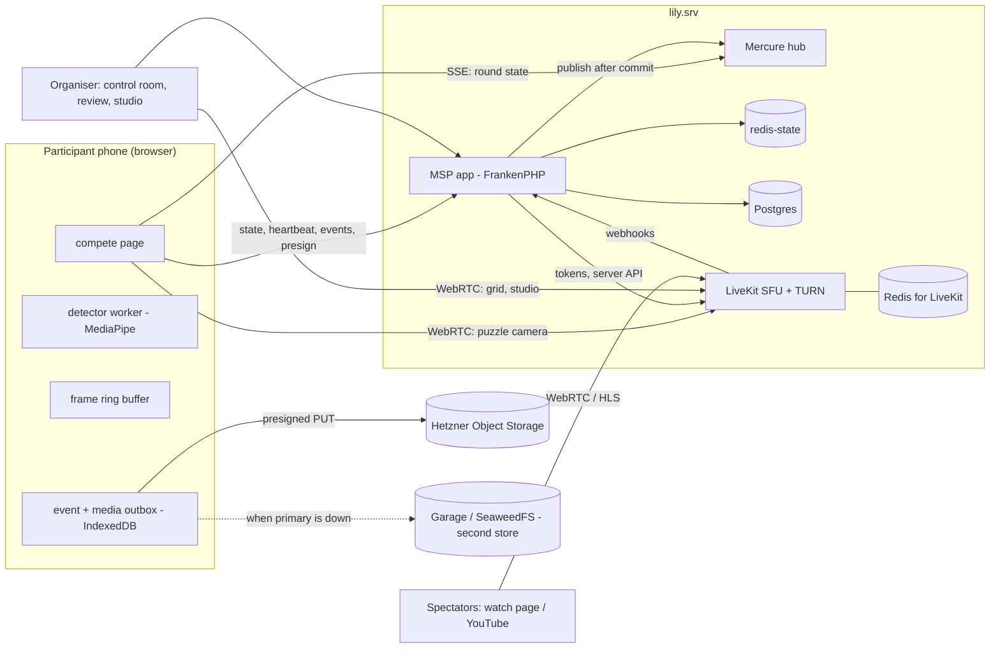

# Online competitions — implementation plan (prototype → Q1 2027)

**Status:** plan, 2026-10-13. Nothing built. Design of record and every decision: [README.md](README.md) (§13 = Jan's decisions + the defaults taken). This file says *what gets built, in which order, by whom, and how we know it works*.

**Target:** the first public online competition on MySpeedPuzzling in **Q1 2027**. Before it, every phase ends with **our own test competition** on production ("MSP Online Test Cup #N", a real event configured like any other, behind the feature flag) - real phones, real home networks, real puzzles.

---

## 0. Principles

1. **Autodetection reliability is the key to success** (Jan). Every test cup produces the accuracy report (README §5.9): detection error (confirmed − detected moment), delta (tap − detection), misses both ways. Every detector change is judged by those numbers.
2. **Correctness never depends on the network being nice.** The start is a timestamp, finishes are device timestamps on a synced clock, every push has a pull behind it, every upload has a buffer behind it.
3. **Opt-in, invisible until used.** New tables, a feature flag for enabling online timing (admins + chosen organisers), untouched competitions render byte-identical (the competition features' existing rule, pinned by their page and query-budget tests).
4. **Open source and self-hosted only.** Hetzner (servers + Object Storage) is the only paid thing, as today.
5. **The project's rules apply unchanged** (CLAUDE.md): writes through Messenger handlers, repositories only persist, `ClockInterface`, UUIDv7, single-action controllers, generated migrations, PHPStan max, all 6 locales before a PR, feature flags documented, `docs/TODO.md` for loose ends.
6. **Build fast, test on real devices often.** The schedule is set by the test cups (volunteers, real events), not by coding.

---

## 1. Milestones

| Milestone | Target date (tentative) | Content | Proven by |
|---|---|---|---|
| **M0 - spikes** | Tue 2026-11-03 | footage recorded, bench running, endurance / clock / load / video spikes done; detector + completeness approach chosen with data | `spikes.md` with the numbers |
| **M1 - remote stopwatch** | Tue 2026-11-10 → **Test Cup #1** | links + QR, participant page (clock, countdown, stopwatch, Finished + bursts, time's up), control room, evidence to S3, review → official results | 5-10 volunteers, one round, results published |
| **M1B - live room + studio** | Tue 2026-12-01 → **Test Cup #2** | LiveKit on lily, puzzle cameras in the moderator grid, host voice, studio with invited finishers, spectator watch page | 10-20 volunteers + spectators, a commentator |
| **M2 - hands-up detection** | Tue 2027-01-12 → **Test Cup #3** | MediaPipe worker, finish candidates + bursts, `on` mode, accuracy report | detection error + misses on real finishes |
| **M3 - completeness advisory** | Tue 2027-02-02 → **Test Cup #4 (rehearsal)** | OpenCV check advisory in the review, dataset collection; 30-50 participants + load tests | reviewer minutes per participant, false "complete" = 0 |
| **M4 - scale & public event** | March 2027 | spectators at scale (HLS / YouTube), media server decision, Mercure hardening, storage failover drill, organiser + participant guides | the first public online competition |

Phases 0, 1 and 1B run in parallel; Phase 2 starts when the bench (S2) says which models and rules to use.

**The test cups** are real competitions on production, configured by us:
- an online one-time event "MSP Online Test Cup #N". **Test Cup #1 stays a draft**, so it never appears in any public list: personal links work for drafts (the token is the access right, like the draft's own editors), and `DraftCanaryTest` gets the new public surfaces. **From Test Cup #2 on, the cup is published** like any event, because spectators need a public watch page - a public test is fine, and it doubles as a teaser. Jan's call per cup;
- one solo round of 30-60 min with a known puzzle;
- volunteers imported as participants; their links go out as MSP Mailer drafts that Jan approves.

Test Cup #1's results stay on the draft (visible to its editors); the published cups publish their results like any event.

---

## 2. Architecture



**New moving parts:** LiveKit (Phase 1B), a Redis for it, Garage / SeaweedFS as the second store (Phase 1 code path, deployed by M4 at the latest), a small CV worker (Phase 3), LiveKit Egress (Phase 4, spectators at scale / recordings). Everything else is the existing stack.

---

## 3. Contracts (agreed before parallel work starts)

These are fixed at the start of each phase in a contract file (the participants-spreadsheet recipe: contract + foundation commit, then parallel work). Shapes below are the starting point.

### 3.1 Participant API (stateless, the personal token authenticates)

`GET /-/time` → `{"serverNowMs": 1792000000123}` (`no-store`, the `stateless` firewall)

`GET /api/compete/{token}/state`

```json
{
  "serverNowMs": 1792000000123,
  "asOfMs": 1792000000120,
  "participant": {"id": "…", "name": "…", "connectedPlayer": null},
  "competition": {"id": "…", "name": "…"},
  "round": {
    "id": "…", "name": "…", "minutesLimit": 60, "piecesTotal": 500,
    "startedAtMs": null, "stoppedAtMs": null, "stateHash": "…",
    "settings": {"detection": "on", "video": true, "seeEachOther": false, "studio": true, "unfinishedMeasure": "left"}
  },
  "entry": {"confirmedMomentMs": null, "candidates": 0, "taps": 0, "reportedPieces": null, "review": "pending"},
  "mercure": {"url": "…", "topics": ["/round-stopwatch/…"], "token": "…", "expiresAt": "…", "expiresIn": 3600}
}
```

The round shown is the participant's current one: a running or scheduled clock first, then the next round by schedule.

`POST /api/compete/{token}/heartbeat` - every 15 s

```json
{"deviceId": "…", "roundId": "…", "visible": true,
 "camera": {"ok": true, "w": 1920, "h": 1080, "fps": 30},
 "detector": {"ok": true, "fps": 4.8, "mode": "on"},
 "clock": {"offsetMs": -1234.5, "rttMs": 38},
 "outbox": {"events": 0, "media": 2}}
```

→ `{"serverNowMs": …, "stateHash": "…", "takenOverBy": null}`

`POST /api/compete/{token}/events` → `{"serverNowMs": …, "acks": ["…"], "refused": [{"id": "…", "reason": "…"}]}`

```json
{"deviceId": "…", "events": [
  {"id": "<uuidv7>", "type": "finish.button", "roundId": "…",
   "clientMs": 1792002832345, "perfMs": 2832345.5, "offsetMs": -1234.5, "rttMs": 38,
   "data": {"burstMediaId": "…", "photoMediaId": "…"}}]}
```

Event types: `consent.given`, `device.ready`, `countdown.seen`, `start.seen`, `finish.candidate` (Phase 2), `finish.button`, `finish.button.undone`, `camera.lost`, `camera.back`, `page.hidden`, `page.visible`, `network.offline`, `network.online`, `timeup.pieces`, `media.uploaded`, `detector.changed` (stream P2F), `page.reloaded` (stream RP: `{goneMs, screen}` - the page (re)opened while the round runs on a device that was ready). Unknown types are refused, never fatal; idempotent by `id`.

`POST /api/compete/{token}/media` → a presigned upload

```json
{"deviceId": "…", "roundId": "…", "kind": "burst", "takenMs": 1792002832345, "bytes": 1534000, "contentType": "application/octet-stream"}
```

→ `{"mediaId": "…", "store": "primary", "method": "PUT", "url": "…", "headers": {"Content-Type": "…", "Content-Length": "…"}, "expiresAtMs": …}`; the phone PUTs, then sends `media.uploaded` `{mediaId, bytes, manifest?}`. A burst is one object: concatenated JPEG frames, its manifest `[{offset, length, captureMs}]` travels in the `media.uploaded` event.

`POST /api/compete/{token}/video-token` (Phase 1B) `{"deviceId": "…", "room": "hall" | "studio"}` → `{"url": "wss://…", "token": "…", "identity": "p:…"}`

`POST /api/compete/{token}/studio-invites/{inviteId}` (Phase 1B) `{"answer": "join" | "decline"}`

`POST /{_locale}/compete/{token}/connect` - signed in, stateless CSRF (§5.4 of the README: the auto-connect rules)

### 3.2 Client modules (`assets/online/`, pure ES modules, injected I/O, node-tested)

| Module | Contract |
|---|---|
| `clock_sync.js` | `createClock({fetchTime, now, timeOrigin})` → `sync()`, `observe({t0, t1, serverNowMs})`, `serverNow()`, `quality()` (offset, best RTT, age); min-RTT window, slew small corrections, jump after sleep |
| `round_state.js` | `deriveView(state, serverNowMs)` → `{screen: 'waiting' \| 'scheduled' \| 'countdown' \| 'running' \| 'ended', countdownMs, elapsedMs, remainingMs}`; `newer(a, b)` by `asOfMs` |
| `event_outbox.js` | generic outbox over `createIndexedDbStorage()` / `createTabLock()` from `official_results_outbox.js`: `enqueue(event)`, batches, backoff, one sending tab, `beforeunload` guard |
| `media_outbox.js` | `enqueue({kind, blob, takenMs, eventId, priority})` → presign → PUT → `media.uploaded`; priorities (critical kept, periodic thinned under quota pressure, `navigator.storage.estimate()`) |
| `frame_buffer.js` | `createFrameBuffer({fps: 10, seconds: 5, width: 640, height: 360, encode})` → `push(frame, captureMs)`, `burst(momentMs, {before: 5000, after: 5000})` → `{blob, manifest}` |
| `camera.js` | open / re-open the camera (lens choice shared with the barcode scanner), `mute` / `unmute` / `ended`, wake lock (request on the ready tap, re-request on every return) |
| `finish_machine.js` (Phase 2) | `createFinishMachine({mode, holdMs: 500, cooldownMs: 10000})` → `signal({captureMs, raised, hands, confidence})` → candidates |
| `detector.worker.js` (Phase 2) | messages `init {models, delegate: 'CPU'}`, `frame {bitmap, captureMs}` → `signal {captureMs, raised, hands, pose, confidence, inferenceMs}` |
| `livekit_session.js` (Phase 1B) | `joinHall({url, token, cameraTrack, allowSubscribers})`, `joinStudio(…)`, `leave()`, events: connection quality, invite received, permissions changed |

### 3.3 Server pieces (names to keep)

- **Entities / tables:** `OnlineRound` (settings per round), `OnlineEntry` (PK = the `competition_participant_round` id: device, clock quality, confirmed moment + source, reported pieces, review status / reviewer), `OnlineEntryEvent` (append-only, PK = client UUID, `client_ms` bigint, `received_at_ms` bigint, `payload` jsonb), `OnlineEntryMedia` (kind, store + key, bytes, uploaded / verified, manifest + verdict jsonb), `StudioInvite`; `competition_participant.online_token` (+ created at). Millisecond moments as `bigint` epoch ms - Doctrine's `datetime_immutable` drops the fraction on PostgreSQL.
- **Messages:** `ScheduleRoundStart` (countdown / scheduled start), `CancelRoundStart`, existing `StopRoundStopwatch` (= end for online rounds), `EnableOnlineRound`, `UpdateOnlineRoundSettings`, `GenerateOnlineTokens`, `RegenerateOnlineToken`, `RecordOnlineEntryEvents`, `RegisterOnlineMedia`, `VerifyOnlineMedia` (async HEAD), `ConfirmOnlineResult` (review + official result in one transaction under `CompetitionParticipantsLock`, through `RecordRoundResults`' planning code, acting player = reviewer), `InviteToStudio`, `AnswerStudioInvite`, `EndStudioGuest`, `PruneOnlineMedia` (cron), `CheckOnlineFinishPhoto` (Phase 3, async).
- **Services:** `OnlineAccess` (token → participant, rate limit), `OnlineRoundState` (the state JSON), `OnlinePresence` (redis-state hash per round, one Lua call per heartbeat), `OnlineMediaStorage` (presign, primary / secondary, circuit breaker), `LiveKitTokens` (JWT via lcobucci/jwt), `LiveKitApi` (Twirp JSON over HttpClient), `OnlineRoundsFeature` (the flag).
- **Organiser endpoints:** online timing settings, links (+ CSV, QR sheet), control room page + `live.json`, start / cancel / end, review list + detail + confirm, accuracy report, studio invite / end, moderator video token; `POST /-/livekit-webhook`.

### 3.4 Conventions every stream follows (from the code, 2026-10-13)

- **Entities:** plain `#[Entity]` classes with public promoted properties, `#[Immutable]` on what never changes (`PRIVATE_WRITE_SCOPE` for properties changed only through named methods), ids `UuidType` + `Uuid::uuid7()`, enums with `enumType`, `Types::JSONB` (with a `'[]'` default when not null), `Types::BIGINT` for epoch milliseconds. Templates: `RoundResultChangeReceipt`, `PuzzlingTeamArchive`.
- **Migrations:** generated with `doctrine:migrations:diff`, never hand-written (except `custom_*` indexes), never run by an agent; renumber after main's hand-numbered ones if needed.
- **Repositories:** `readonly final` around `EntityManagerInterface`; `get()` (checks `Uuid::isValid()`, throws a `…NotFound extends NotFoundHttpException`), `save()` = persist only, `delete()`.
- **Messages / handlers:** flat `src/Message/` + `src/MessageHandler/`, `readonly final`, `#[AsMessageHandler]`, results through `HandledStamp`, `ClockInterface`; participant / entry / team writes implement `SerializedByLock` with `CompetitionParticipantsLock`; nested work after the handler with `DispatchAfterCurrentBusStamp`; domain events via `EntityWithEvents` (they dispatch on post-flush - **inside** the transaction).
- **Mercure:** publish from the controller after `dispatch()` returned (`OfficialResultsLiveUpdates` pattern: static `topic()`, typed JSON, failures logged, never thrown).
- **Organiser pages:** locale route maps, `#[IsGranted('IS_AUTHENTICATED_REMEMBERED')]` + `denyAccessUnlessGranted(COMPETITION_EDIT | COMPETITION_RESULTS_ENTRY, $competitionId)`, `_breadcrumb` + back button, `private, no-store`, listed in `ResolveAnnouncementModal::QUIET_ROUTES`; JSON endpoints use `OfficialResultsApi`'s envelope and its stateless CSRF header.
- **Flags:** env var → parameter → service `isEnabled()` → Twig global, defined in the committed `.env`, documented in `feature_flags.md`, tests via `OverridesFeatureFlagEnv`.
- **Commands:** dispatch a message, the handler is what gets tested; cron rows in lily.srv `apps/myspeedpuzzling/cron.d`, noted in `docs/TODO.md`.
- **Tests:** handlers on `KernelTestCase` (dispatch + raw SQL asserts), controllers on `WebTestCase` + `TestingLogin::asPlayer()`, `NullMercureHub::getPublishedUpdates()`, `QueryCountAssertions` with itemised budgets, JS through node harnesses (`tests/*-harness.mjs` + a PHPUnit wrapper).
- **Front end:** a lazy Stimulus controller (`/* stimulusFetch: 'lazy' */`) importing plain, Stimulus-free ES modules (`assets/online/`), so node can test them; JS commands in the `js-watch` container, never a manual build.

---

## 4. Work packages

### Phase 0 - spikes (start now, parallel to Phase 1)

| Spike | Deliverable | Who |
|---|---|---|
| **S1 - footage** | 15-20 recorded solves following a written protocol (`spikes.md` §S1): 2-3 phones (an older iPhone, a mid-range Android), angled and top-down, daylight and evening, 300-1,000 pieces, ≥ 3 low-texture motifs; every finish with raised hands, a few premature raises, a few with one piece missing; the empty mat filmed first. A label file per video: last piece, hands up, complete or not. **Stored outside the public repo** (private bucket / local) | Jan + volunteers; protocol and label format from me |
| **S2 - bench** | `tools/online-bench/` (code only, no footage in the repo): a local page that plays a video frame by frame through the pose / gesture models and writes signals per frame; a node runner that feeds them through `finish_machine.js` and scores detection error / misses against the labels; a Python + OpenCV script for the completeness approaches over the finish frames → confusion matrix | me (agents) |
| **S3 + S4 - lab page** | an admin-only page (feature flag, removed or kept as practice mode later): camera at 1080p + detector at 5 fps + wake lock + a countdown to a server-scheduled moment; it reports fps, inference ms, clock offset / RTT, visibility and camera mute events to the server every 15 s. Run 90 min on 3-4 phones (heat, battery, tab survival, a call, a lock); film 5 phones' countdowns side by side at 240 fps | me (page), Jan + volunteers (phones) |
| **S5 - load + storage** | `tools/online-load/`: a k6 script (heartbeats, events, presigning, SSE) + Mercure's Gatling scenario; presigned PUT + CORS checked on Hetzner Object Storage and on a Garage test instance; a failover drill (primary blocked → uploads land on the secondary, nothing on lily's disk) | me |
| **S6 - video** | LiveKit on lily (or a small Hetzner Cloud VM first) with TURN; `lk load-test` 100 → 300 publishers + moderators + spectators; three real phones publishing + detecting for 90 min; a studio invite round trip; a strict-network test (TURN/TLS) | me + Jan (infra approval) |

**Exit:** `spikes.md` with the numbers and the choices they lead to (detector model + thresholds, completeness approach, cadences, LiveKit config, whether lily holds Test Cup #2).

### Phase 1 - remote stopwatch (the core flow, no video, no detection)

New code lives in `src/Controller/Compete/` (participant), `src/Controller/OnlineRounds/` (organiser), `src/Services/OnlineRounds/`, flat `src/Message/` + `src/MessageHandler/`, `templates/compete/`, `templates/online_rounds/`, `assets/online/`.

| WP | Content | Done when |
|---|---|---|
| **1.1 Round clock with a countdown** | `CompetitionRound`: a scheduled start on a whole second (`ScheduleRoundStart` - "Start in 10 s" or a chosen moment), `CancelRoundStart` while it hasn't started; status **`scheduled`** until then (fails safe: any reader we missed sees "not running", never a negative time); `StopRoundStopwatch` = end for online rounds (no resume). **Publish after the commit** for all stopwatch messages: the handlers stop publishing; the controllers publish once `dispatch()` has returned, through a `RoundStopwatchLiveUpdates` service (the official-results convention - a Doctrine post-flush handler would still run before the commit). State endpoint + payload gain `serverNowMs`, `startedAtMs`, `stoppedAtMs`, `asOfMs`, `stateHash` (the ATOM fields stay). Every reader of the stopwatch columns handles `scheduled`. Today a future start already shows a running 00:00:00 on the projector page and "Running 0:00" in live entry. The readers:
- PHP: the entity + the three handlers, `RoundStopwatchStateController`, `GetRoundResultsOverview` (SQL + `SeatingReadiness`), `RoundResultsOverview` JSON, `LiveResultsCurrentRound` (already future-safe), `GetParticipantsSheetState` (its `started` flag must not count `scheduled`), `MoveRoundToCompetitionHandler` (`scheduled` blocks a move like `running`);
- Twig: `manage_round_stopwatch`, `round_stopwatch`, `competition_results_overview`, `live_results`;
- JS: `round_stopwatch_controller.js` (shows the countdown), `live_results_controller.js` (no Finished-now before the start), `results_overview_controller.js`, `official_results_live.js`, the participants sheet's `round_common.js` / `round_cards_view.js`.

The stopwatch forms get a stateless CSRF token (today they post without one). | entity + handler tests, the 21 existing stopwatch tests stay green; the projector page counts down; an untouched round behaves exactly as before |
| **1.2 Clock sync** | `GET /-/time` (`stateless` firewall); `assets/online/clock_sync.js` + `tests/clock-sync-harness.mjs` + `ClockSyncScriptTest` | the harness scenarios pass; S4 confirms on phones |
| **1.3 Online round settings + flag** | `OnlineRound` (one row per round that uses online timing): detection mode, video, see-each-other, studio, unfinished measure, missing-piece rule; `EnableOnlineRound` / `UpdateOnlineRoundSettings`; an "Online timing" page per round (organisers, `COMPETITION_EDIT`, only while the flag lets them); the flag = `OnlineRoundsFeature` (admins always, organisers by an allow-list / env switch), documented in `feature_flags.md` | enabling works only for the flag's people; nothing changes for other rounds |
| **1.4 Personal links** | `competition_participant.online_token` (+ created at); `GenerateOnlineTokens` (for every participant of a competition with an online round, also later additions), `RegenerateOnlineToken`; links page (copy, CSV, printable QR sheet with bacon-qr-code); a read-only "Personal link" column in the participants sheet (`people_view.js` column options, an `<a>` cell; the `people()` SQL + `ParticipantsSheetPerson`); "Open my competition page" in the event page's taking-part card (`event_parts/_taking_part.html.twig`; `GetEventAttendance` learns the participant id, it only knows "is going" today) | tokens unique, regenerate kills the old link, sheet prints |
| **1.5 Participant API** | `^/api/compete/` as its own stateless firewall entry (no session, no user - the controller resolves the token through `OnlineAccess`; the signed-in `connect` stays on `main`); a sliding-window limiter `online_participant` keyed by token (`TooManyRequestsHttpException` with `Retry-After`); the JSON envelope of `OfficialResultsApi` (`{"error": "<code>"}`, `private, no-store`); state, heartbeat (`OnlinePresence` behind an interface: one Lua call into redis-state on `kernel.terminate`, the API-usage pattern - telemetry, not app state; TTL on every key, because redis-state is capped at 64 MB with noeviction; an in-memory double in `services_test.php` + one real-Redis test), events (`RecordOnlineEntryEvents`, idempotent by client id, a race on the primary key = already acked), media (`RegisterOnlineMedia` with an id generated before dispatch, then `OnlineMediaStorage::presignPut()`; `VerifyOnlineMedia` async HEAD), connect (signed in, stateless CSRF, the auto-connect rules → existing `ConnectCompetitionParticipant`) | controller tests: no session cookie ever set, 4xx always JSON, rate limits answer 429 + `Retry-After` |
| **1.6 Participant page** | `/{_locale}/compete/{token}` (`no-store`, `Referrer-Policy: same-origin`), base layout without header/footer like the projector page, **no Turbo navigation at all** (iOS camera, §5.5 of the README); the Mercure subscription from a new public `OfficialResultsSubscription` method for participant pages (its `forTopics()` is private today); lazy `compete_controller.js` as a thin shell over `assets/online/*` (clock, round state, event + media outbox, frame buffer, camera + wake lock, beeps); screens welcome → checklist → waiting → countdown → running → finish recorded → time's up → after; consent; desktop "continue on your phone" QR; in-app browser notice; takeover; the Finished tap takes a photo + a burst | real-device pass on the matrix (§6): a reload, 2 min offline, a camera mute and a takeover all end with a valid result |
| **1.7 Control room** | `/{_locale}/online-rounds/{roundId}/control` (`COMPETITION_EDIT`; a locale route map like every organiser page, `_breadcrumb` + back button, listed in `ResolveAnnouncementModal::QUIET_ROUTES`; linked from `official_results/_round_tool_links.html.twig` and the event's ⋯ menu `events/_manage_items.html.twig` for online events): the clock, Start in 10 s / Cancel / End now, presence grid (Redis: ready, camera, clock quality, last seen) with the latest periodic photo (short-lived presigned GET), finishes as they come; polling `live.json` every 2-3 s | `live.json` within its query budget; 100 simulated participants render smoothly |
| **1.8 Review** | `/{_locale}/online-rounds/{roundId}/review` (`COMPETITION_RESULTS_ENTRY`): list + detail, burst scrubber (the burst fetched once, frames sliced by the manifest), keyboard-first; `ConfirmOnlineResult` stores the confirmed moment, its source and the reviewer **and** records the official result in the same transaction, under the same `CompetitionParticipantsLock` (`SerializedByLock`; `SerializedByLockMessagesTest` insists), applying it through `RecordRoundResults`' own planning code (acting player = the reviewer, `from` = the result the reviewer saw - a result entered meanwhile at the desk comes back as a 409 conflict, never overwritten) - never two transactions; unfinished → pieces placed | a round reviewed end to end, results published, "Add to my profile" works |
| **1.9 Storage** | `OnlineMediaStorage`: AsyncAws `presign()` of `PutObject` with signed type + length, key prefix `online/…`, primary = the existing bucket, secondary = an optional S3 endpoint from env, circuit breaker counters in redis-state; bucket CORS for `PUT` from the site's origin (Hetzner console / API); retention: `myspeedpuzzling:prune-online-media` (daily) → `PruneOnlineMedia` | presigned PUT works from Safari + Chrome; a blocked primary sends uploads to the secondary (S5) |
| **1.10 Fixtures, translations, docs** | an `OnlineRoundsFixture` in the style of `OfficialResultsFixture` (an online competition, a round with online timing, participants with tokens - one connected, one anonymous -, events, media rows, a reviewed entry), documented in `.claude/fixtures.md`; translation roots `compete:` (participant page) and `online_rounds:` (organiser pages), JS texts through a JSON Stimulus value or a texts partial + a `*TextsTest`, plurals through `browser_translation()`; all keys in 6 locales; CLAUDE.md feature line; README updated | §8 definition of done |

### Phase 1B - live room and studio (parallel to Phase 1)

| WP | Content | Done when |
|---|---|---|
| **1B.1 Infrastructure** | §5 below: LiveKit + its Redis on lily, Traefik routes (signalling + TURN/TLS passthrough), firewall (UDP mux, TCP 7881, TURN/UDP 3478), DNS, secrets, metrics + alerts, resource limits | `lk load-test` from outside reaches it; a phone on mobile data and one on a strict Wi-Fi connect |
| **1B.2 MSP ↔ LiveKit** | `LiveKitTokens` (JWT via lcobucci/jwt: identity, name, room, `canPublishSources`, `canSubscribe`), `LiveKitApi` (Twirp JSON over HttpClient: `CreateRoom`, `UpdateParticipant`, `SendData`, `RemoveParticipant`, `ListParticipants`), `POST /-/livekit-webhook` (signature check) | tokens accepted, permission change takes effect live, webhook verified |
| **1B.3 Participant video** | publish the puzzle camera to the hall (simulcast 180p / 360p / 720p, dynacast), subscriber permissions (moderators only, or all when "see each other" is on), the host's voice (unlocked by the ready tap), connection quality; the studio invite prompt → leave the hall → join the studio with mic + camera → "On air" → back | the camera keeps feeding the detector and the frame buffer while publishing; a phone that can't connect still competes |
| **1B.4 Moderator console** | the control room gains the video grid (one page ~25 tiles, adaptive stream, ordered by status), spotlight 720p, push-to-talk into the hall, "Invite to the studio" on every finisher, studio controls (on air / end), the host's studio view (camera + mic) | a commentator runs Test Cup #2 alone |
| **1B.5 Spectators** | a public watch page per round (subscribe-only studio tokens), a participant counter, "full" handling until Phase 4 brings HLS; the OBS how-to for YouTube | 300 simulated spectators in S6 |
| **1B.6 Second screen** | the same personal link opened on a laptop / tablet chooses "second screen": stopwatch, Finished, the host, the studio, others (when on) - no camera | a laptop + phone set-up in Test Cup #2 |

### Phase 2 - hands-up detection

| WP | Content |
|---|---|
| 2.1 Model hosting | MediaPipe WASM + pose lite + gesture recognizer under a versioned path outside `/build/` (immutable cache headers) with its own service-worker cache rule; prefetch during the checklist |
| 2.2 Detector worker | `assets/online/detector.worker.js`: one instance per session, CPU delegate, frames from `requestVideoFrameCallback` as transferable `ImageBitmap`s, adaptive rate (target 4-5 fps, backs off when inference is slow), signals stamped with `captureTime`; main-thread fallback at 2 fps |
| 2.3 Finish machine | `assets/online/finish_machine.js` (hold 0.5 s, cooldown 10 s, candidate = first raised frame, modes `off` / `shadow` / `on`); node harness with synthetic sequences + sequences recorded by the bench |
| 2.4 Candidate flow | candidate → sharp photo + burst (frame buffer from Phase 1) → `finish.candidate` event; participant feedback (green flash, chime, "keep going and raise again if a piece is missing"); the set-up test "raise both hands"; LiveKit participant attribute so a candidate jumps to the top of the moderator grid at once |
| 2.5 Accuracy report | per round and across rounds: detection error, delta, misses both ways, by device / browser / camera placement; CSV for the bench |

### Phase 3 - completeness check (advisory)

| WP | Content |
|---|---|
| 3.1 CV worker | a small service (Python 3, OpenCV, ONNX Runtime; HTTP or a queue consumer) as a container next to the app; reads photos by presigned GET, answers a verdict; `CheckOnlineFinishPhoto` (async Messenger) calls it and stores the verdict on the media row |
| 3.2 Inputs | empty-mat photo in the set-up (already captured from Phase 1), reference image per round (catalogue photo, organiser upload) |
| 3.3 Algorithms | background holes + reference-grid matching as chosen by the bench, thresholds in config; verdict = complete / gaps (with boxes) / unsure + a confidence |
| 3.4 Review integration | verdict badges, suspected holes drawn over the photo, the queue ordered by "needs a look" first |
| 3.5 Dataset | consented export of candidate photos + bursts + reviewer verdicts (outside the repo) for training our own model later |

**State (stream P3, 2026-10-14):** 3.1-3.4 **built, switched off** (`ONLINE_CV_URL` empty) - README §5.8 "Built (stream P3)". 3.1: the worker `tools/online-cv/` (HTTP, host allowlist, bounded queue, read-only container; no ONNX yet - no model to run), `CheckOnlineFinishPhoto` → `online_media_check` (a table of its own, one row per photo per worker version - the reserved `online_entry_media.verdict` column stays unused), `myspeedpuzzling:online-cv:check-round`. 3.2: the empty mat = the entry's `empty_mat` photo, the reference = the round puzzle's catalogue image; an organiser upload is a TODO. 3.3: the bench's holes + grid unchanged, plus loose pieces next to the puzzle → `unsure`; thresholds untuned (real photos). 3.4: badges, gap boxes, "needs a look" first, the accuracy report's line. 3.5 and the production deployment (a box change): docs/TODO.md.

### Phase 4 - scale and the public event

| WP | Content |
|---|---|
| 4.1 Spectators at scale | LiveKit Egress renders the studio once → HLS (low-latency where supported) to object storage or our own nginx edge, played with hls.js; RTMP to YouTube / Twitch as an option per competition; the watch page switches from WebRTC to HLS by audience size; spectator load test |
| 4.2 Media server | decide from the test cups: stay on lily or move LiveKit (+ Egress) to a dedicated Hetzner server; LiveKit multi-node via Redis when one node isn't enough; pods (rooms of 16-25) if participants see each other at scale |
| 4.3 Mercure hardening | cap the Bolt history, scrape its metrics, alerts; a plan for sharding only if the numbers ask for it (the open-source hub is single-node) |
| 4.4 Storage failover live | Garage / SeaweedFS deployed as the second store, the circuit breaker on, a failover drill on production at a quiet hour |
| 4.5 Recording option | track egress of the puzzle cameras straight to S3 with egress's `backup` storage, per competition |
| 4.6 Guides | organiser guide (set-up, links, control room, studio, review) and participant guide (set-up rules with photos, practice mode) in all 6 locales |
| 4.7 Public event | the first public online competition; the flag opens to the organisers who run it |

---

## 5. Infrastructure changes (lily.srv)

lily's rules (lily.srv `CLAUDE.md`, `docs/decisions.md`):
- **every change on the box needs Jan's explicit "yes"**;
- choosing a technology is an ADR with alternatives (the next number is D78);
- **only Traefik publishes ports** - WireGuard is the one written exception;
- a new port needs a Hetzner **Robot firewall** rule (IPv4, stateless, a limited number of rules per direction, ~7 already used - check the cap) **and** a ufw rule. For a Docker-published port that is `ufw route allow`, because of ufw-docker's `DOCKER-USER` chain;
- Traefik has no TCP / UDP routers yet, and a change to its static config restarts it (every site blips);
- MSP is a class-D app: compose changes take effect on the next deploy, and new services must be added to `deploy.sh`'s explicit list.

**The minimal footprint for LiveKit** (S6 confirms it before Phase 1B):

| Need | Proposal | Why this way |
|---|---|---|
| Signalling (`wss://live.myspeedpuzzling.com`) | a normal HTTP router on the `websecure` entrypoint, `le-dns` certificate, an edge middleware chain like Mercure's | nothing new |
| Media | **one published UDP port** (LiveKit's UDP mux, e.g. 7882) - not a 10,000-port range | one Robot rule, one `ufw route allow`, one docker-proxy |
| Strict networks | **TURN/TLS on 443** through a Traefik **TCP router by SNI** (`HostSNI(turn.myspeedpuzzling.com)`) on the existing 443 entrypoint - a dynamic-config change, hot-reloaded, no Traefik restart; either passthrough (LiveKit holds the certificate) or TLS terminated by Traefik with LiveKit's external-TLS mode | the only way through networks that allow nothing but 443/TCP; no new public port |
| ICE/TCP 7881, TURN/UDP 3478 | **left out at first**: the server has a public IP, so clients behind any NAT reach the UDP port directly, and TURN/TLS covers the rest | saves two Robot rules; added only if S6 shows a gap |
| Redis for LiveKit | a dedicated instance (the stateful-image pin already used for redis-state), never the cache Redis | LiveKit and its recorder use it for coordination |
| Secrets | `LIVEKIT_API_KEY` / `LIVEKIT_API_SECRET` in Infisical (prod), `livekit.yaml.template` with `__KEY__` placeholders filled by `dump_secrets` | the existing template pattern (listmonk) |
| DNS | `live` and `turn` as DNS-only (grey cloud) records to the apex in Cloudflare | WebRTC and TURN can't go through Cloudflare's proxy |
| Monitoring | LiveKit's Prometheus port with the `metrics.scrape` labels on the `monitoring` network; alert rules + promtool tests; the `ContainerHighCPU` threshold (1.5 cores / 30 min) raised for LiveKit; NIC throughput is already on the hardware dashboard | see an event coming before it hurts |
| Host tuning | larger UDP socket buffers (`net.core.rmem_max` / `wmem_max`, recommended for SFUs) - not set on lily today | packet loss under load |
| Unknowns to check in S6 | the NIC's link speed (`ethtool eno1` - not documented; one bulk job saw ~580 Mbit/s each way), any traffic quota, IPv6 (the box has an address, the Docker bridges are IPv4-only) | capacity numbers depend on them |

**Later (Phase 4):**
- LiveKit Egress as its own container. It needs CPU and memory: a studio render runs a headless browser.
- Garage / SeaweedFS as the second store, on another machine.
- The CV worker (Phase 3) as an internal-only container with no public port.
- A dedicated media server if the test cups ask for one.

---

## 6. Testing

**Automated (CI, every PR):**

- **PHP:** handler tests for every message (scheduled start, cancel, the readers of a future start, idempotent events, presign + store choice, confirm → `RecordRoundResults`, studio invite lifecycle, connect rules), controller tests for the participant API (token, rate limit, stateless - no session cookie set) and the organiser pages (voters), a query budget for `live.json` and the state endpoint, the canaries the codebase already has where a new surface lists people (blocklist, private profiles, drafts).
- **JS (node harnesses, the `tests/*-harness.mjs` pattern):** `clock_sync` (min-RTT, asymmetric routes, sleep jump, `Date`/`performance` divergence, slew), `round_state` (every screen, late joiner, cancelled countdown, newer-state rule), `event_outbox` / `media_outbox` (offline, retry, priorities, quota), `frame_buffer` (window maths, manifest), `finish_machine` (synthetic and recorded signal sequences: hold, cooldown, re-raise, mode `shadow`).
- **Byte-identical guards:** an untouched competition renders exactly as before (the competition features' existing page tests + statement counts).

**Real devices (every test cup, a written protocol):**

| Device | Why |
|---|---|
| iPhone on iOS 17 / 18 / 26 / 27 (Safari, and once as a home-screen app) | camera muted when hidden, wake lock rules, SSE in background, WebGL2 in workers from 17 |
| a mid-range Android (Samsung A-series) + a Pixel, current Chrome | lens choice, heat, encoder + detector together |
| a low-end Android | the support floor - button-only must still work |
| desktop Chrome / Safari / Firefox | organiser console, second screen, spectators |

**Load (before Test Cups #2 and #4, at a quiet hour - Tue/Wed 05-07 Prague):** a k6 script (AGPL-3.0) for heartbeats / events / presigning, Mercure's Gatling scenario through the real Traefik path, `lk load-test` for LiveKit (100 → 300 publishers, moderators, spectators).

**Real-browser pass before each PR** (the participants-spreadsheet recipe): a scratch copy of the dev database, a private Mercure hub, Selenium for the organiser pages, and real phones for the participant page.

---

## 7. Delivery - how it is orchestrated

Per phase, the recipe that delivered the participants spreadsheet and the marketplace-at-events work:

1. **Contract file + foundation commit** (entities, migrations generated by Doctrine, message classes, empty endpoints, module stubs with their tests failing) - so parallel streams can't drift.
2. **Parallel streams, one git worktree + own `_test` database per agent**, a slot lock on the test suite (max 2 at a time). After entity changes, `rm tests/.database.cache` in the worktree.
3. **Merge**, then **review rounds**: per area (backend, participant page, organiser pages, infra) + one business review against the README; fixers per area.
4. **Real-browser + real-device pass** on a scratch copy of the dev database.
5. **Translations** into all 6 locales by parallel translators + the parity / plural checker.
6. **PR → CI (ParaTest shards) → merge → deploy-fast → smoke test on production → the test cup.**

Guardrails that bit before:
- the checkout is shared with other sessions - stage own files only, `git commit -- <paths>`;
- migrations are generated, then renumbered if main has hand-numbered ones after them;
- the repository is public - no real participant names or footage in it (bench footage lives outside the repo);
- every refusal visible in the UI, never only in a console;
- every 4xx of a JSON API answered as JSON;
- Mercure publishes after the commit;
- an open editor's "from" is what it showed when it opened.

**Phase streams:**

| Phase | Parallel streams |
|---|---|
| 0 | S1 footage (Jan + volunteers; protocol from me) · S2 bench · S3/S4 lab page · S5 load scripts · S6 LiveKit test box |
| 1 | A backend core (entities, messages, participant API, presence, presign, clock countdown) · B participant page (modules + page against the contract) · C organiser pages (settings, links, control room, review) · D storage + retention + flag + docs |
| 1B | A infra (lily.srv: LiveKit, Redis, Traefik, firewall, DNS, monitoring) · B MSP ↔ LiveKit (tokens, API client, webhooks, studio messages) · C participant video + studio join · D moderator console video + studio controls · E spectator watch page |
| 2 | A detector worker + model hosting · B finish machine + bench-recorded sequences · C candidate flow + UI feedback + moderator jump-to-top · D accuracy report |
| 3 | A CV worker service · B empty-mat + reference image capture · C review verdict overlays + dataset export |
| 4 | per item (spectators at scale, media server, Mercure, storage failover, recordings, guides) |

---

## 8. Definition of done per phase

A phase is done when **all** of these hold:

1. Its test cup ran on production and its numbers are written down in `test-cups.md` (participants, devices, what broke, accuracy report from Phase 2 on).
2. CI green: PHPStan max, PHPCS, the full ParaTest suite, `doctrine:schema:validate`, `cache:warmup`, the node harnesses.
3. Every new translation key exists in all 6 locales (parity + plural checker).
4. Untouched competitions render byte-identical; query budgets hold.
5. `README.md` updated where the design moved, `docs/features/feature_flags.md` and `docs/TODO.md` updated, a CLAUDE.md feature line once the first phase ships.
6. Loose ends recorded in `docs/TODO.md`, not in someone's head.

---

## 9. Risks for the plan itself

| Risk | Answer |
|---|---|
| Volunteers and footage (S1) arrive late - detection waits for data | Phase 1 and 1B don't need it; S1 starts this week with Jan's own solves; the lab page (S3) can also record practice runs with consent |
| Real devices behave differently from the docs (iOS camera, heat) | S3 / S6 before building on top; every test cup has a device matrix |
| lily is shared - a video load test or a test cup slows other apps | quiet-hour tests, resource limits on the new containers, the dedicated media server as the planned exit |
| The prototype grows into the "Meet + Twitch hybrid" before the basics are reliable | phases in order; spectators at scale and multi-node only in Phase 4, after the detection numbers are good |
| Parallel sessions in the same checkout | worktrees per stream, own-files-only commits, `origin/main..main` check before pushing |

---

## 10. To start

What I need from Jan before the first stream starts:

1. **This plan** - approved, or changed where it is wrong.
2. **Phase 0 + Phase 1 may start now** (no infrastructure change needed; Phase 1 ships behind the flag).
3. **Footage (S1):** Jan records the first solves following the protocol in `spikes.md` (I write it first), and picks volunteers for Test Cup #1.
4. **lily.srv for Phase 1B:**
   - an OK to prepare ADR D78 (LiveKit on lily, the alternatives, the port exceptions, §5);
   - then a separate "yes" for each box change, as lily's rules require.

   Until then, S6 can run on a small Hetzner Cloud VM, so lily stays untouched.
5. **The defaults in README §13** ("smaller choices") - silence means they stand.

