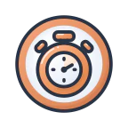
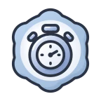
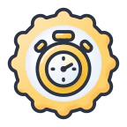
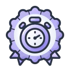
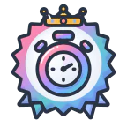
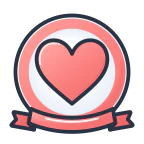
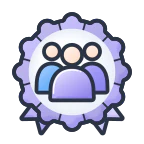
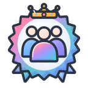

# Badge art generator (`tools/badge-art`)

This tool draws every achievement badge image of MySpeedPuzzling: 17 badge types, 81 badge images, each as an
optimised SVG plus WebP and PNG rasters. Everything is generated from code in this directory and committed:
- the art in `public/img/badges/`;
- the icon sources in `icons/svg/`;
- the frozen frame bases in `bases/`.

It also rebuilds the last-piece reveal geometry (`reveal/geometry.py`, see the section of that name).

Generation runs **on a developer machine only**. It never runs in CI or in the Docker image build, and
`.dockerignore` already excludes `tools/`. There is no AI, no GPU and no network: Python + shapely draw SVG, and
`rsvg-convert` rasterises it.

| T1 Bronze | T2 Silver | T3 Gold | T4 Platinum | T5 Diamond | one-off (F1S-A) |
|---|---|---|---|---|---|
|  |  |  |  |  |  |
|  |  |  |  |  | |

## Quick start

All commands run from the repository root. `-B` keeps Python from writing `__pycache__` next to the sources (the
scripts also switch it off themselves).
```sh
python3.14 -m venv tools/badge-art/.venv                                  # once (gitignored)
tools/badge-art/.venv/bin/pip install -r tools/badge-art/requirements.txt  # once; also rsvg-convert + cwebp on PATH
PY=tools/badge-art/.venv/bin/python
$PY -B tools/badge-art/build.py    # build everything (~46 s)
$PY -B tools/badge-art/qa.py       # the gate (~115 s): must say PASS
open tools/badge-art/work/contact-48.png     # look at the 48 px contact sheet
git add tools/badge-art public/img/badges    # commit code and generated files together
```
- `rsvg-convert` and `cwebp` on macOS: `brew install librsvg webp`.
- The exact versions are in `requirements.txt` and `toolchain.json`.

## Decisions (owner: Jan, 2026-10-10)

1. **Frames: F1 seal ladder v2.** Every tier changes the silhouette:
   - T1: circle;
   - T2: 6 scallops;
   - T3: 12 scallops;
   - T4: 12 scallops + pleats + ribbon tails;
   - T5: 18-ray sunburst + tails + crown, in the saturated logo prism.

   T5 has **no sparkle stars**.
2. **No white gloss arcs** on any base, tier or one-off. The bases keep only the soft same-hue wash; the icons keep
   their own highlights.
3. **Icons:** the 17 illustrated icons (lab agent IK1) are approved as v1.
   - On 2026-10-10, 8 of them were tuned (same concepts) so every icon fills ≥ 49 % of the badge and is ≥ 25 %
     tier tint; see "Icon tuning".
   - **Unboxed** = solved without looking at the box picture. Its icon is a crossed-out eye (`unboxed_eye`,
     owner pick 2026-10-10). The rejected concepts stay in `icons/draw.py` as variants.
4. **One-off (single-tier) badges** sit on the **F1S-A ribbon seal**: a white paper seal, a ring in the set colour,
   and a ribbon banner across the bottom.
   - A one-off badge has a `set_colour` (`coral`, `sky`, `lavender` or `teal`) and an optional icon `accent`.
   - The accent is chosen per badge by its meaning, but should follow the set colour; it defaults to the set colour.
   - Supporter is a one-off: coral set, coral accent.
5. **Everything is committed** on the badges branch: generator, frozen bases, icon sources, QA gate, docs and the
   generated art.
6. **Ship both formats:** an optimised SVG, and pre-rendered rasters (WebP for the site, PNG for e-mails).
7. **The locked state stays CSS** (greyscale + 45 % opacity). There are no locked-state assets.
8. **Motion in v1** is limited to the static badges plus the P2 last-piece reveal (badge reveal page and XP launch
   reveal). Motion lives in the templates and Stimulus code, not here.

## What gets built

```
public/img/badges/
  svg/<type>-<tier>.svg            optimised SVG (inline-safe: ids carry a per-file prefix)
  webp/<px>/<type>-<tier>.webp     px 96 / 144 / 192 / 320 / 480 = 2x of the display sizes 48 / 72 / 96 / 160 / 240
  png/<px>/<type>-<tier>.png       px 96 / 144 (e-mails, absolute URLs)
  holo/<type>-t4|t5-foil|rim.png   the detail sheet's medal: foil + rim masks of Platinum and Diamond (400 px)
  holo/back-<hash>.png             the medal's back plate, shared by every badge of a frame (named by content)
  manifest.json                    {"version", "types", "holo", "files", ...}
```
- **`holo/` (lib/holo.py)**: the achievement detail sheet turns the 200 px medal over and gives Platinum a foil rim and
  Diamond the "Masterpiece" finish (docs/features/xp-levels/ux-polish/design-spec.md §2). Everything the effect needs
  is worked out here instead of in the browser (P3 measured 60-480 ms per badge there): from the shipped SVG rendered
  at 400 px, the body (largest shape, holes filled) and its distance transform give the foil mask (light fills; the
  frame band fully, inside it only light unsaturated areas - ink stays ink), the rim mask (the frame band only) and
  the back plate (the body opened by 4 % of the canvas, mirrored, a wash of the sampled rim tone, the edge tone as
  outline, an engraved groove). `manifest.json` `holo.<type>.<tier>` = `foil`/`rim` (t4/t5, else null), `back`,
  `tones.rim`/`tones.edge`, `field` (centre x, y and radius of the back's text area, % of the picture). Read through
  `BadgeArtManifest::holo()` / Twig `badge_holo()`. numpy + scipy + Pillow (already pinned), deterministic: the golden
  check covers it. Adds ~0.15 s per tiered badge to the build.
- **`<type>`** is the `BadgeType` enum value exactly (`src/Value/BadgeType.php`).
- **`<tier>`** is `t1` … `t5` (BadgeTier 1–5) for tiered types, and `single` for one-off types.
- **`manifest.json`** fields:
  - `version`: the first 12 hex characters of a sha256 over every output file. Templates append it as `?v=` for
    cache-busting; Twig reads it through `badge_art_url()` / `badge_art()`.
  - `types`: per type, `icon`, `kind`, `tiers` and `title`, plus `set_colour` and `accent` for one-offs.
  - `files`: a sha256 per file.
  - `bases`: the status of each base.
  - `formats`: the sizes and the encoders.
- **Rasters** are rendered from the shipped SVG at each size, never downscaled from a big image, so small sizes keep
  pixel-snapped outlines.
  - **WebP (site):** `cwebp -q 90 -m 6 -alpha_q 100 -sharp_yuv`: lossy colour, lossless alpha. See "WebP encoding"
    below for why.
  - **PNG (e-mail):** always lossless, 8-bit RGBA, zlib level 9, no metadata.
- **The build owns `svg/`, `webp/`, `png/` and `manifest.json`.** It deletes stale files there and warns about
  anything else in the directory.

### WebP encoding (measured 2026-10-10)
Lossless WebP made the catalogue page pull ~0.74 MB on high-DPI screens (TW). The measurements on 5 badges × 5
sizes, against the exact render:
- **Plain lossy WebP (Pillow, q88–92)** saves 45–53 %. But WebP subsamples colour 4:2:0, so saturated 1–3 px
  details lose their colour whatever the quality:
  - the T5 crown's gold tips and band turn grey-beige at 96/144 px, and the coral gem turns mauve;
  - the crown visibly dulls next to lossless at 1:1 (48/72 px display on a 2× screen).
- **`cwebp -sharp_yuv`** (sharper RGB→YUV) keeps the crown gold and the gem coral. At 1:1 it is indistinguishable
  from lossless at every size; only the crown's 1 px blue dots lose their hue.
  - Pillow cannot do `sharp_yuv`, hence the libwebp reference CLI. It is deterministic: identical bytes over pipes
    and files, every run.
- **Near-lossless (`-near_lossless 60`)** keeps every colour (max ΔE 3.8) but saves only 13 %.
- **Result:** WebP 7.27 MB → 3.89 MB (−47 %); the catalogue page (17 cards at 192 px + 81 tier icons at 96 px)
  ~0.74 MB → 0.39 MB.
  - The `rasters` gate keeps it honest: WebP alpha exact, PSNR ≥ 30 dB (lowest file 31.8 dB). PNG stays
    pixel-exact.

## How it works

```
registry.py ──> icons/draw.py ──> icons/svg/<icon>-<colourway>.svg    (msp + t1..t5 + set colours one-offs use)
                                    │  optical fit into the slot (lib/compose.py)
bases/*-under.svg ──> compose: base(under) + icon + base(over) ──> lib/svgopt.py ──> svg/
bases/*-over.svg  ─┘                                                        └──> rsvg-convert @ px ──> webp/, png/
                                                                                        manifest.json (hashes)
```
- **`registry.py`** is the ONE list of badges. Each line holds a type, an icon, a drawing function and a kind
  (`TIERED` or `SINGLE`); a single badge also has `set_colour` and an optional `accent`. Nothing else lists types or
  icons.
- **`icons/`**: `draw.py` has one function per icon, `illus.py` is the toolkit (path builder, palettes, tier tints,
  fit, light), `colourway.py` makes the set-colour tints, `gate.py` is the icon QA gate, and `svg/` holds the
  generated sources.
- **`frames/`**: `f1.py` holds the tier bases, `f1s.py` the one-off base and its set colours, `kit.py` the shared
  drawing kit. This is only used by `freeze_bases.py`.
- **`bases/`**: the frozen output of `frames/`, plus `bases.json` with the slot constants and a sha256 per layer.
  - The build **never** regenerates a base, and it stops if a base file differs from its recorded hash.
  - `freeze_bases.py` exports them. It needs `--force` to replace frozen files.
- **`lib/`**: `paths.py` (every path, checked), `compose.py` (BK1's exact icon placement and optical fit),
  `svgopt.py` (optimiser), `raster.py` (rsvg-convert, cwebp, PNG), `toolchain.py`.
- **`reveal/`**: `geometry.py` (the last-piece reveal JSON + tray SVG) and `fonts/` (the pinned Rubik variable font,
  OFL).

## Style rules

### Frame and slot (every base)
- **Canvas:** 1024 × 1024, transparent.
- **Outline:** ONE navy `#2b3445`, 27 px (2.64 % of the canvas), round caps and joins, on the frame AND the icon.
  - Interior frame lines (the T4 pleats) are 0.6 × that.
  - There are at most two navy rings: the frame outline and the icon's own outline.
- **Plate:** a white plate of radius 308 px, `#ffffff` → `#e9eff8`, with no navy ring.
- **Icon slot:**
  - the icon's bounding box (stroke included), longer side = 0.53 × canvas = **542.72 px**, centred on (512, 512);
  - **optical fit:** the icon shrinks only if its farthest opaque point would leave radius **300 px** (plate − 8).
    That point is measured on an rsvg render, and the fit refines up to 3 times. Round icons keep 53 %; boxy ones
    shrink (`qa.py` reports the size; below 49 % is a warning).
- **Padding:** 6 % (geometry stays inside 512 ± 451 px).
- **Light:** same-hue washes, 8 L\* lighter at the top-left, and a soft blurred shade band at the bottom-right. There
  is no gloss.
- **Tier tones** (frames: light / base / shade / deep):

| tier | name | base | shade | silhouette |
|---|---|---|---|---|
| t1 | Bronze | `#E28F60` | `#C9724A` | circle seal r 376 |
| t2 | Silver | `#A8C2E0` | `#86A2C6` | 6 big scallops (hexafoil) |
| t3 | Gold | `#FDD26F` | `#F6B24C` | 12 scallops |
| t4 | Platinum | `#B9B0F4` | `#9389E8` | 12 scallops + pleats + 2 ribbon tails |
| t5 | Diamond | logo prism `#FF9EB0` → `#F987AE` → `#C09AEA` → `#62C8D2` → `#74AEF6` → `#8E9CF2` | | 18-ray sunburst + tails + crown (over the icon) |

- **One-off base (F1S-A ribbon seal):**
  - a white paper seal (r 402) and a set-colour ring (72 px wide) around the same plate and slot;
  - a smile-curved ribbon banner with notched tails, drawn over the icon's area. Its inner edge clears the icon's
    fit circle by 18 px, so any icon fits.
  - Set colours (base / shade):

    | set colour | base | shade |
    |---|---|---|
    | coral | `#FB8180` | `#EE6769` |
    | sky | `#75B5FA` | `#5A9FF0` |
    | lavender | `#9A93F4` | `#7D76E3` |
    | teal | `#8FD5DA` | `#69C3C8` |

  - A one-off never uses ladder vocabulary: no scallops, hanging tails, sunburst, crown, stars or sparkles.
  - Set colours are brand tones, never metals.

### Icons (contract enforced by `qa.py`)
An icon is drawn in a 100 × 100 box and written with three tagged layers, always in this z-order:

```
<g id="face">     fills that never change with the tier (dial, glass, compass card, team-mates, snow ...)
<g id="accent">   what the tier tints (bezel, flame, piece body ...) + its rim lights, glint and bevel shade
<g id="outline">  every navy line: 4.5 units (renders 27 px in the badge), round caps/joins, + navy ink details
```
1. **Draw OBJECTS. People appear only as faceless figures** (team-spirit: plain head circles).
   - Never draw faces or eyes, or animals or characters with faces. At 24–48 px, eyes read as spectacles or holes:
     a test owl was the busiest icon of its set and read as spectacles.
   - One object, readable at 24 px, mirror-symmetric where the object allows it.
   - No motion dashes, no detached marks.
2. **Centred:** the stroked bounding box is centred on (50, 50) and its longer side is 80. `illus.fit()` does this;
   draw at roughly the final size.
3. **One navy, one weight.**
   - The outline is 4.5 units.
   - Interior details may be thinner, but at least 0.55 × 4.5 = 2.5 units.
   - No stroke anywhere in the icon may be wider than 4.5: the badge scales the widest stroke to the frame's 27 px.
4. **Fills are same-hue washes.** Fill roles:

   | role | what it is |
   |---|---|
   | `"acc"` | the tier's main wash (the badge's tint) |
   | `"acc-pale"` | the tier's pale pair (wedges, small fills) |
   | `"acc-deep"` | the tier's deep tone as a solid fill. It is also usable as a stroke colour: `ic.hl(..., color="acc-deep")` is what draws the bevel shade |
   | `FACE` keys | constant paints: `face`, `metal`, `sky`, `sky-pale`, `lavender`, `lav-pale`, `teal`, `coral`, `glow`, `snow`, `skin` |
   | any `#rrggbb` | used as is |

5. **The house light is automatic.** `light(ic, layer, shape)` adds three things: a white rim light just inside the
   outline at the top-left, one glint dot past its upper end, and a deep-tone bevel shade at the bottom-right.
   - **Steer it** with `tl={...}` (rim light) and `br={...}` (shade). They are passed to `illus.rim()`:
     - `side`: `"tl"`, `"br"`, `"l"`, `"r"` or a vector `(x, y)`;
     - `thresh`: how squarely the outline must face the light; the cosine is 0.5 by default, and lower values give
       longer highlights;
     - `trim`: the share cut off both ends (0.12);
     - `min_len`: the shortest run kept (7 units);
     - `max_runs`: how many separate runs to keep (1; the jigsaw piece uses 3, one per knob);
     - `inset`: the distance inside the outline (stroke/2 + 1.25).
   - **Other options:** `glint=False` drops the dot, `shade=False` drops the shade, and `rim_w`, `shade_w`,
     `shade_op` and `shade_col` set widths, opacity and colour.
   - For a shape partly hidden behind another one, pass `clip=<clip_out id>`.
6. **Holes, cut-outs and catch-lights.** The layer order is fixed, so an accent shape must never cover a face shape.
   - **Rings and holes:** use `ic.fill("accent", Path().extend(outer).extend(inner), "acc", rule="evenodd")` (the
     stopwatch bezel, the flame).
   - **Hiding back outlines:** `ic.clip_out("front", front_path)` makes a clip that keeps everything outside the
     front shape. Pass `clip="front"` to `ic.line()` or `ic.fill()` for the parts behind it (team-spirit, sofa,
     lotus).
   - **Catch-lights:** use `ic.dot(layer, x, y, r)` for white dots (default opacity = the tier's rim strength) and
     `ic.hl(layer, path, width)` for white highlight strokes (the stopwatch crown).
   - **Prints:** an unoutlined white silhouette in the ACCENT layer, so it sits on the tint (brand-explorer's tag;
     worked example below). Jigsaw prints come from `jigsaw_piece(..., stroke=0.0)`.
   - Mark deliberately asymmetric details `cls="asym"`. The symmetry gate ignores them.
7. **Navy details.** Navy details belong in the outline layer, which is always on top:
   - `ic.line(path, width=...)` for lines;
   - `ic.ink(path)` for navy fills (hands, pivots).

   The QA gate also accepts navy fills in the face layer. Its contract polices only the outline layer: there,
   strokes and fills must be navy and strokes at least 2.5 wide. But the face layer is drawn under the accent, so the
   tint covers its navy. Use it only for navy that must sit behind an accent shape. Face navy counts as ink for the
   24 px legibility and symmetry gates, and it must be identical in every colourway (tint integrity).
8. **Chunky for 24 px. No hairlines.** Two outlines either merge (centres < 4.5 apart) or run at least 2 units apart.
   A sliver of light between near-parallel strokes fails the `no_slivers` gate.
9. **Jigsaw pieces only through `jigsaw_piece()`.** It builds one knob or socket per side, all identical, with the
   tangent construction (rule 5, checked by the gate).
   - An outlined piece needs a side of at least ~35 units (no knob anatomy passes rule 5 below that with a 4.5
     outline; checked numerically).
   - **Exception:** the border pieces of a complete puzzle (`border=True`, piece-cruncher) may have flat, straight
     outer sides, like a real jigsaw. They still need ≥ 2 connectors, and every inner side has exactly one.
   - `corner=` takes one radius or one per corner (TL, TR, BR, BL), e.g. a big rounded outer corner.
10. **Accent area:** the visible accent should be ≥ 25 % of the icon. `qa.py` warns below it. Every v1 icon is at
    0.27 or more since the tuning. The binding check is the 24 px accent visibility gate (≥ 0.10).
11. **Fill the plate:** the badge shrinks an icon whose farthest point leaves the plate (radius 44.2 units around the
    centre in the 100 box = 53 %). Square and wide-based silhouettes lose size at their corners. Round the corners,
    narrow the base, or curve it, and keep the far points within ~46 units (≥ 51 %). `qa.py` warns below 49 %.

## Add a badge

Every new badge type first needs its `BadgeType` case in `src/Value/BadgeType.php` (plus translations, criteria and
so on, outside this tool). Until registry and enum agree, the build stops.

### A new tiered badge type: worked example (hourglass)
1. **Draw it.** Append to `icons/draw.py`:
   ```python
   def hourglass():
       ic = Icon("hourglass", "Patient Puzzler - hourglass", symmetric=True,
                 notes="an hourglass: tier-coloured sand and end caps (accent), white glass (face), navy outline")
       glass = Path().M(31.0, 25.0).C(31.0, 41.0, 45.0, 45.0, 45.0, 50.0).C(45.0, 55.0, 31.0, 59.0, 31.0, 75.0)
       glass.L(69.0, 75.0).C(69.0, 59.0, 55.0, 55.0, 55.0, 50.0).C(55.0, 45.0, 69.0, 41.0, 69.0, 25.0).Z()
       ic.fill("face", glass, "face")                                           # the glass: constant white
       sand_top = Path().M(37.0, 36.0).C(41.0, 42.0, 47.0, 45.5, 50.0, 47.5).C(53.0, 45.5, 59.0, 42.0, 63.0, 36.0).Z()
       sand_bottom = Path().M(33.5, 72.5).C(36.0, 64.0, 44.0, 60.0, 50.0, 59.0).C(56.0, 60.0, 64.0, 64.0, 66.5, 72.5).Z()
       caps = [rrect(50.0, 20.5, 52.0, 10.0, 4.5), rrect(50.0, 79.5, 52.0, 10.0, 4.5)]
       for sand in (sand_top, sand_bottom):
           ic.fill("accent", sand, "acc")                                       # the tier tints the sand ...
       for cap in caps:
           ic.fill("accent", cap, "acc")                                        # ... and the two end caps
           light(ic, "accent", cap, tl={"thresh": 0.30, "trim": 0.12}, br={"thresh": 0.45})
       ic.line(glass)
       for cap in caps:
           ic.line(cap)
       return ic
   ```
2. **Register it.** Add one line to `BADGES` in `registry.py`:
   ```python
   Badge("patient_puzzler",      "hourglass",       D.hourglass,         TIERED,  "Patient Puzzler"),
   ```
3. **Iterate.**
   - `$PY -B tools/badge-art/qa.py --icon hourglass` (~5 s) runs the icon gate on the freshly drawn icon and writes
     `work/qa-icon-hourglass.json`.
   - `$PY -B tools/badge-art/build.py --only patient_puzzler --out tools/badge-art/work/preview` (~7 s) shows the 5
     badges. A preview never touches `public/`.
   - Measured for this example: all gates pass, icon 49.4 % of the badge, visible accent 0.34.
4. **Finish.** Run `build.py` and `qa.py` (PASS), look at `work/contact-48.png`, then commit `icons/draw.py`,
   `registry.py`, `icons/svg/hourglass-*.svg` and `public/img/badges/` (the new type's 40 files + `manifest.json`).

### A print on the body: worked example (shopping bag)
A print is an unoutlined white silhouette in the accent layer, so it sits on the tint (like brand-explorer's tag):
```python
def shopping_bag():
    ic = Icon("shopping-bag", "Market Seller - shopping bag", symmetric=True,
              notes="a shopping bag in the tier colour with two navy handles and a white print of the classic "
                    "die-cut piece (2 knobs, 2 sockets) - a print like brand-explorer's tag")
    body = round_poly([(24.0, 36.0), (76.0, 36.0), (82.0, 88.0), (18.0, 88.0)], [4.0, 4.0, 5.0, 5.0])
    ic.fill("accent", body, "acc")
    light(ic, "accent", body, tl={"thresh": 0.30, "trim": 0.10}, br={"thresh": 0.45})
    ps = 22.0                                     # the print: an UNOUTLINED white silhouette in the accent layer
    pc = jigsaw_piece(50.0 - 0.175 * ps, 63.0 + 0.175 * ps, ps, ("out", "out", "in", "in"), stroke=0.0)
    ic.fill("accent", pc, "#ffffff", opacity=0.96, cls="asym")
    ic.line(body)
    for cx in (38.0, 62.0):                       # handles: navy loops in the outline layer
        ic.line(arc(cx, 36.0, 8.0, -90.0, 90.0))
    return ic
```
- **Why it is built this way:**
  - `stroke=0.0` because an outline would fill the sockets at this size;
  - the bbox offset `± 0.175 × ps` centres the classic piece;
  - `cls="asym"` because a piece always points one way.
- **Measured:** all gates pass and the visible accent is 0.73. The frame-fit warning reads "icon 44.5 %": the bag's
  bottom corners are its farthest points, so it shrinks. Rounder bottom corners and a narrower base fix it; that is
  how the old unboxed box went from 43.7 % to 50.5 % (see "Icon tuning").

### A one-off (single-tier) badge
A one-off is one registry line with `SINGLE`, a `set_colour` and optionally an `accent`:
```python
Badge("supporter",            "supporter",       D.supporter,         SINGLE,  "Supporter", set_colour="coral"),
```
- It builds one file, `<type>-single`, on `bases/f1s-a-<set colour>-*`.
- The icon is re-tinted to the accent colour (`icons/colourway.py`: only the accent stops and the bevel shade change;
  coral = the `-msp` file).
- `BadgeType::isTiered()` must return false for it. Write it in one of the forms the build can verify:
  - `return $this !== self::A;`
  - `return !in_array($this, [self::A, self::B], true);`
  - `return match ($this) { self::A, self::B => false, default => true };`

### A one-off badge set: worked example (3 badges sharing a set colour)
An event set (the "Launch Week" name is made up; the repo is public, so never use real event or player names) in
teal. It reuses existing icons, and the flame keeps a coral accent because it is fire:
```python
Badge("launch_week_explorer", "explorer",    D.explorer,    SINGLE, "Launch Week Explorer", set_colour="teal"),
Badge("launch_week_on_fire",  "streak",      D.streak,      SINGLE, "Launch Week On Fire",  set_colour="teal",
      accent="coral"),
Badge("launch_week_team",     "team-spirit", D.team_spirit, SINGLE, "Launch Week Team",     set_colour="teal"),
```
- **PHP:** add the three enum cases and
  `return !in_array($this, [self::Supporter, self::LaunchWeekExplorer, self::LaunchWeekOnFire, self::LaunchWeekTeam], true);`
  in `isTiered()`.
- **The build then:**
  - writes three `*-single` files on `f1s-a-teal`;
  - adds the icon sources `explorer-teal.svg` and `team-spirit-teal.svg` (the coral flame is `streak-msp.svg`);
  - gates them.
- Tested end to end with `build.run()` on 2026-10-10: three teal ribbon seals, with the flame in coral.
- **A new set colour** = one row in `frames/f1s.py` `SETS`, then `freeze_bases.py single-<colour>`. Keep it a
  brand tone, at least dE 12.1 from every tier (lavender vs platinum is the tight pair).

## Change nothing else

- **The build is deterministic.** A re-run writes nothing ("0 changed"), and the golden check in `qa.py` rebuilds
  everything into a temporary directory and fails on any byte difference. So:
  - **Never edit generated files by hand.** That covers `icons/svg/`, `public/img/badges/`, `bases/` and
    `bases.json`. Change the code and rebuild.
  - **An icon change** (draw.py) changes only that icon's sources, its badges' files and `manifest.json` (a new
    `version`).
  - **A new registry line** only adds files (+ manifest).
  - **The bases are frozen.** Frame code changes do nothing until `freeze_bases.py --force <key>`, and that is a
    deliberate, reviewable act: every badge on that base changes.
  - **The reveal files** (`assets/last_piece_reveal/geometry.json`, `assets/img/last-piece-reveal-tray.svg`)
    change only through `reveal/geometry.py`.
- **Toolchain:** `toolchain.json` records rsvg-convert, cairo, pango, cwebp + libsharpyuv, Python and the
  libraries (incl. Pillow's zlib-ng, shapely's GEOS, fonttools). The build warns loudly when the local versions
  differ.
  - A renderer or encoder update can change pixels or bytes; the golden check shows it.
  - Upgrade deliberately: `build.py --record-toolchain`, rebuild, review the art, commit toolchain + art together.
- **Paths:** every path is resolved from `lib/paths.py` and checked: the tool must sit at `<repo>/tools/badge-art`,
  or it stops.
  - Outputs go only to `public/img/badges`, `icons/svg` or an explicit `--out`.
  - Scratch work goes to a temporary directory or `work/` (gitignored).

## Commands and flags (all of them)

| command | what |
|---|---|
| `build.py` | the full build (icons + all badge art + manifest); prunes stale managed files |
| `build.py --only TYPE [--only TYPE ...] --out DIR` | preview some types into DIR (refuses `public/img/badges`; writes a manifest with `"partial": true`; no icon sources) |
| `build.py --icons-only` | only regenerate `icons/svg` |
| `build.py --out DIR --icons-out DIR` | full build elsewhere (the golden check uses this) |
| `build.py --jobs N` | worker processes (default: all cores) |
| `build.py --record-toolchain` | write the local versions to `toolchain.json` |
| `qa.py` | the full gate: golden, icons, selftest, optimiser, rasters, warnings, contact sheet; writes `work/qa.json` |
| `qa.py --icon NAME [--icon NAME ...]` | icon gate only on the freshly drawn icon(s); writes `work/qa-icon-NAME.json`, never `qa.json` |
| `qa.py --jobs N` | worker processes |
| `freeze_bases.py [KEY ...] [--force]` | export bases (`t1`..`t5`, `single-coral`/`-sky`/`-lavender`/`-teal`) |
| `reveal/geometry.py` | rewrite the last-piece reveal JSON + tray SVG (only when they change) |
| `reveal/geometry.py --check` | exit 1 if the committed reveal files differ from a fresh build |

Exit codes:

| code | meaning |
|---|---|
| 0 | ok / PASS |
| 1 | build error or gate FAIL: unknown icon function, registry ≠ enum, missing or edited base, refused freeze |
| 2 | bad command line: an unknown type or icon name, or a preview aimed at `public/` |

## The QA gate (`qa.py`)

| check | rule |
|---|---|
| golden | the committed `public/img/badges/**`, `icons/svg/*.svg` and the two reveal files equal a fresh rebuild, byte for byte |
| contract | viewBox 100, the face/accent/outline groups in order, no text/image/filter, a navy-only outline layer, details ≥ 2.5 |
| centred | bbox centre within ±0.5 units; long side 80 ± 0.5 |
| symmetric | mirror IoU without `asym` details: silhouette ≥ 0.98, ink ≥ 0.93 (symmetric icons only) |
| outline width | outer outline median 4.2–4.8 units, p10 ≥ 3.9 |
| no dashes | no detached component |
| no slivers | no light region < 1.8 units wide, ≥ 2 long and elongated ≥ 2.5 |
| legible at 24 px | ink 0.15–0.50, edges ≥ 0.18, accent visibility ≥ 0.10, thin-fill ≤ 0.15 |
| tints | face and outline identical across msp/t1..t5; accent dE ≥ 12 from the face; tier steps ≥ 10 |
| rule 5 | one knob/socket per side (border pieces of a puzzle: flat outer sides allowed); jigsaw anatomy (head 29–36 % of the side, neck 0.62–0.76 × head, protrusion 30–40 %, no pinched neck) |
| selftest | 6 negative controls must each fail their gate |
| optimiser | every shipped SVG vs its unoptimised master at 1024 px: ≤ 1 level on ≥ 99.9 % of pixels |
| rasters | every PNG pixel-identical to a fresh render of the shipped SVG; every WebP with exact alpha and PSNR ≥ 30 dB |
| warnings | frame fit < 49 % of the badge; visible accent < 0.25 |

The 48 px contact sheet (`work/contact-48.png`) shows every badge on white, on page grey `#f6f9fc`, and locked.

## Verification done for v1 (2026-10-10)
- **Pixel identity with the lab** (1024 px renders vs the lab's current code: BK1 `render.py F1 <icon>` without gloss
  arcs, and `render.py F1S <icon> --set-colour …`):
  - 17 icons × 5 tiers + 17 icons × 4 set colours = **153 badges, 0 differing pixels**;
  - the icon sources are byte-identical to the lab's 102 IK1 SVGs.
- **SVG optimiser:**
  - the lossless steps (exact path re-encoding, `<use>` for shared shapes, defs merge) are pixel-identical;
  - only the blurred shade bands are simplified (Douglas-Peucker, 0.01 × σ px): worst badge 99.95 % of pixels
    within 1 level.
  - T5 shrank from 303–310 kB (95 kB gzip) to 51–54 kB (14–14.5 kB gzip).
- **Determinism:** two full builds give byte-identical trees (`public/img/badges`, `icons/svg`, `bases`; 0 files
  changed).
- **After the icon tuning:** the 9 untouched icons are byte-identical to the IK1 originals, and `qa.py` reports 0
  failures and 0 warnings.
- **Reveal geometry:** `reveal/geometry.py` reproduces RV2's committed `geometry.json` and tray SVG byte for byte.

## Performance (Apple M3 Max, 14 cores = 10P + 4E, 36 GB; default 14 workers; GPU none; network none)

Measured with `/usr/bin/time -l` on 2026-10-10:
- *max RSS* = the largest single process;
- *footprint* = the main process's peak memory footprint;
- *tree RSS* = the summed RSS of all processes, sampled every 50 ms. It is an upper bound, because shared library
  pages are counted per process. `--jobs N` lowers it.

| run | wall | CPU user + sys | max RSS | footprint | tree RSS (processes) |
|---|---|---|---|---|---|
| (a) one type × 5 tiers, all formats: `build.py --only streak --out …` | 7.4 s | 30.4 + 0.7 s | 107 MB | 68 MB | 0.7 GB (13) |
| (b) full build: 17 types, 81 badges, 649 files | 46.4 s | 536.8 + 11.2 s | 121 MB | 78 MB | 2.6 GB (31) |
| (c) icon build: `build.py --icons-only` (17 icons, 102 SVGs) | 2.2 s | 13.1 + 1.7 s | 116 MB | 68 MB | 1.7 GB (18) |
| (d) `qa.py` incl. golden rebuild (47 s), icon gate (~60 s), optimiser + raster checks (~6 s) | 113.2 s | 1031.2 + 41.5 s | 366 MB | 122 MB | 5.2 GB (27) |
| `qa.py --icon speed` (iteration) | 4.9 s | 22.1 + 1.2 s | 386 MB | 67 MB | 2.2 GB (14) |
| `reveal/geometry.py` | 0.5 s | 0.5 + 0.0 s | 75 MB | 61 MB | 76 MB (2) |

- **Where the time goes:**
  - the build's CPU is mostly rsvg rendering and `cwebp -m 6 -sharp_yuv` encoding (405 WebP);
  - the gate's CPU is the icon checks at 1024 px (skeleton, distance transform, openings).
- **Lab comparison:** BK1 `render.py F1 photographer` (5 tiers × one 1024 px PNG) took 1.39 s wall / 119 MB.
- **Disk footprint of the committed art (81 badges):**

| format | files | total | per file |
|---|---|---|---|
| SVG | 81 | 2,410 kB (gzip 647 kB) | T1 9–12 kB, T2 17–19, T3 30–32, T4 38–41, T5 51–54 (gzip 14–14.5), single 21 |
| WebP 96 / 144 / 192 / 320 / 480 | 5 × 81 | 276 / 435 / 587 / 1,020 / 1,575 kB = 3,892 kB | 3.4 / 5.4 / 7.2 / 12.6 / 19.4 kB average |
| PNG 96 / 144 | 2 × 81 | 705 / 1,191 kB = 1,895 kB | 9 / 15 kB average |
| `manifest.json` | 1 | 69 kB | |

- **Sources:** `bases/` 1.2 MB (raw shapely output, as frozen), `icons/svg/` 0.7 MB, `reveal/fonts/` 0.36 MB.
- **Without the optimiser** the SVGs would be 14.5 MB; with lossless WebP the WebP total would be 7.27 MB.

## Icon tuning (2026-10-10, owner decision)
Five icons were too small in the badge: their corners or base left the plate, and the optical fit shrank them.
Five had too little tier tint. All were reworked in `icons/draw.py` with the same concepts, outline, light and palette.

Before/after sheet: `badge-lab/review/icon-tuning-before-after.png`.

| icon | % of the badge | visible accent | change |
|---|---|---|---|
| piece-cruncher | 43.0 → 51.6 | 0.24 → 0.34 | a complete 2 × 2 jigsaw: straight border with big rounded corners (outer sockets made the corners impossible to round) |
| unboxed | 43.7 → 50.5 | 0.33 → 0.27 | box 76 → 58 wide, bottom corners r 5 → 12 (then replaced by the crossed-out eye: 53.0 %, 0.46) |
| marathoner | 44.8 → 50.8 | 0.29 → 0.33 | the range stands on a gentle convex ground arc instead of a straight ground line |
| steady-hands | 45.5 → 51.1 | 0.16 → 0.39 | calendar corners r 8 → 19, taller header, cells in the tier tint at 55 % (was 45 %) |
| first-try | 46.9 → 53.0 | 0.35 → 0.35 | the coral fletching rests on the outer ring instead of outside it |
| librarian | 52.4 → 51.8 | 0.20 → 0.27 | pages 72 → 64 wide, cover 3 units deeper |
| team-spirit | 52.1 → 52.3 | 0.23 → 0.27 | the front (tier-coloured) puzzler 46 → 51 wide |
| cataloger | 49.6 → 51.5 | 0.23 → 0.28 | sheet 44 × 52 → 40 × 50, board corners r 7 → 11 |

### Unboxed concept (owner decision 2026-10-10)
"Unboxed" means solved WITHOUT looking at the box picture. The first icon (an open box with a piece rising out of it)
missed that meaning.

The shipped icon is the crossed-out eye, `unboxed_eye`: 53.0 % of the badge, visible tint 0.46.
- the almond in the tier tint, with a white iris and a navy pupil;
- a navy slash in a white keyline band;
- the almond outline stops at the keyline.

The slash, the keyline and the gapped outline are the declared-asymmetric parts. The almond fill, iris and pupil
stay mirror-symmetric and checked.

| variant (`icons/draw.py`) | status | idea |
|---|---|---|
| `unboxed_eye` | **shipped** | the crossed-out eye, alone |
| `unboxed_eye_off` (A) | rejected | the eye over a box whose lid shows its picture (owner: drop the box) |
| `unboxed_question_box` (B) | rejected | a puzzle box with a big "?" where the picture would be |
| `unboxed_blindfold` (C) | rejected | a puzzle piece with a blindfold band |
| `unboxed` | rejected | the open box with a piece rising out of it (wrong meaning) |

Every variant draws an icon named `unboxed`, so swapping is one word in `registry.py`. Previews:
`badge-lab/review/unboxed-options.png` and `unboxed-final.png`.

## Last-piece reveal geometry (`reveal/geometry.py`)
- **What it writes:** the badge reveal and the XP launch reveal use a 3 × 3 jigsaw cut. The script writes it as:
  - `assets/last_piece_reveal/geometry.json`: the piece outlines, bounding boxes, slots and centroids, the seams,
    and 3 confetti piece shapes;
  - `assets/img/last-piece-reveal-tray.svg`: the unrevealed tray, i.e. the cut plus a Rubik 700 question mark.
- **Command:** `$PY -B tools/badge-art/reveal/geometry.py` rewrites them (only when they change); `--check` only
  compares.
- **Its self-check** (rule 5: one centred, identical connector per interior side; the pieces tile the square) goes to
  `work/reveal-geometry-report.txt`, and an exploded preview to `work/reveal-geometry-check.svg`.
- **Origin:** the code is the lab's P2 `geometry.py` (D06 `knob_template`) plus RV2's `make_tray.py`, moved here with
  only the paths changed. The output is byte-identical to the committed files, and the golden check guards it.
- **The font:** the question mark needs the variable font `reveal/fonts/Rubik[wght].ttf` (Rubik 2.300, OFL,
  sha256-pinned) instanced at wght 700. The static `assets/fonts/Rubik/Rubik-Bold.ttf` has integer-rounded outlines
  and would change the tray's bytes.
- **Changing the geometry** (knob size, the cut, the colours) is a design change: edit the constants, run the
  script, and check the reveal pages. `reveal.js` reads the JSON as data, so its keys must stay.

## Troubleshooting
- **`badge-art: unexpected location`**: run from a checkout where the tool sits at `tools/badge-art`.
- **`rsvg-convert not found`** / **`cwebp not found`**: `brew install librsvg webp`.
- **The toolchain WARNING box**: local versions differ from `toolchain.json`. Run `qa.py`; if golden passes, nothing
  changed. Otherwise see "Toolchain" above.
- **`golden: … differs from a fresh rebuild`**: code changed without a rebuild, or a generated file was edited. Run
  `build.py`, review `git diff`, commit both.
- **`base 'tN': … differs from its frozen sha256`**: revert the base file, or re-freeze on purpose
  (`freeze_bases.py --force tN`).
- **`registry.py lists types that BadgeType.php does not have`** (or the reverse): add the enum case, or remove the
  registry line. **`single-tier kinds differ`**: align `isTiered()` with the `SINGLE` lines.
- **`could not read BadgeType::isTiered()`**: write it in one of the three forms above.
- **A gate fails on your icon**: `qa.py --icon NAME` names the gate.
  - **slivers:** merge two outlines or move them at least 2 units apart.
  - **dashes:** a detached part.
  - **symmetric:** mark intended asymmetry `cls="asym"`, or declare `symmetric=False` for objects that cannot be
    symmetric.
  - **legible_24:** too many thin details.
  - **outline_width:** a stroke is not 4.5, or is too close to the edge.
- **The optimiser gate fails**: `lib/svgopt.py` `BLUR_TOL` was raised, or a new base adds blurred geometry. Keep
  0.01; the lossless steps alone are pixel-identical.
- **The rasters gate fails**:
  - a PNG must equal the render exactly;
  - a WebP must keep exact alpha and ≥ 30 dB. Check `lib/raster.py` `WEBP_ARGS` and the cwebp version.
- **Out of memory / a slow machine**: `--jobs 4`.

## Icon ↔ BadgeType (`registry.py` is authoritative)

| BadgeType | icon | kind | object |
|---|---|---|---|
| `puzzles_solved` | `explorer` | tiered | die-cut piece framing a compass |
| `pieces_solved` | `piece-cruncher` | tiered | 2 × 2 jigsaw, rounded border |
| `speed_500_pieces` | `speed` | tiered | stopwatch |
| `speed_1000_pieces` | `speed-1000` | tiered | stopwatch with a lightning dial |
| `streak` | `streak` | tiered | two-layer flame |
| `team_player` | `team-spirit` | tiered | three faceless puzzlers |
| `zen_puzzler` | `zen-puzzler` | tiered | lotus on water |
| `first_try` | `first-try` | tiered | target with one arrow |
| `unboxed` | `unboxed` | tiered | crossed-out eye (no look at the box picture) |
| `brand_explorer` | `brand-explorer` | tiered | swing tag with a piece print |
| `marathoner` | `marathoner` | tiered | summit with a flag on a rounded hill |
| `photographer` | `photographer` | tiered | camera |
| `steady_hands` | `steady-hands` | tiered | calendar with 4 ticked quarters |
| `librarian` | `librarian` | tiered | open book with a bookmark |
| `weekend_puzzler` | `weekend-puzzler` | tiered | sofa |
| `cataloger` | `cataloger` | tiered | clipboard with a plus badge |
| `supporter` | `supporter` | single (coral / coral) | heart |

## Origins and licence
- **Own work of the MySpeedPuzzling badge lab (2026-10):**
  - the F1 frames (BK1) on the X5 kit;
  - the icons (IK1);
  - the one-off base (SB);
  - the selection and decisions by the owner.
- **One third-party asset:** the Rubik variable font (SIL Open Font License 1.1, `reveal/fonts/OFL.txt`). It is
  used only for the reveal tray's question mark.
- **The lab is not needed to rebuild.** Everything is in this directory, and nothing imports from the lab.
